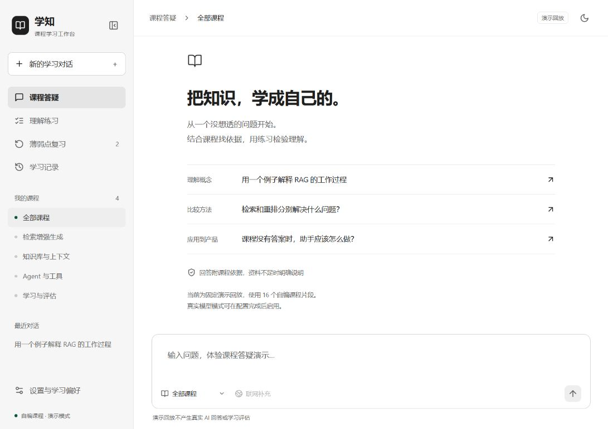

# 学知 · 课程智能学习助手

**当前产品基线：v1.0.0（2026-10-25，个人内测版）。** 我已将功能范围、关键决策、历史实测和未完成验证归档到 [v1.0 产品经理复盘档案](docs/releases/v1.0/README.md)，后续迭代以此对照。版本号表示本次交付基线，正式质量与商业验收仍待完成。版本变化见 [更新记录](CHANGELOG.md)。

我为 AI 产品经理转岗学习者设计并实现了这款课程配套学习助手：先用课程证据回答问题，再用简答与产品场景题检查理解，最后根据真实作答安排薄弱点复习。

这个项目同时是我的 AI 产品经理实践档案。我记录需求假设、技术取舍、实验和失败案例，区分“已经实现”“已经测试”和“尚未验证”。课程机构可能为课后学习支持付费，这是待验证的商业假设，不是已有客户结论。



## 当前交付

- React 学习工作台：课程范围、多轮对话、流式回复、来源侧栏、练习、复习、历史与可删除的学习偏好。
- 本地中文 embedding、BM25＋向量混合检索、RRF、rerank 和父子片段引用。
- 两个角色：学习教练与独立练习评估员；LangGraph 限制题目最多修订一次。
- 原生 Tool Calling、三个按需加载的应用 Skills、SQLite 学习记忆与上下文预算。
- 一个可选的 Tavily MCP 基础搜索集成，默认关闭，项目月度上限 300 次。
- 自编课程、120 条公开检索评测候选、40 条评分候选、私有课程评测准备脚本、测试与产品决策档案。

**运行边界：**默认是明确标注的固定演示回放，不调用 LLM，也不评价用户能力。真实模式需要自行配置 API。真实模型和 MCP 已在本机接入验证；演示回放不能证明模型质量或学习效果。人工评测标签尚待审阅；当前结果见 [验证记录](docs/validation.md)。

## 快速体验（Windows）

需要 Python 3.12、Node.js 22 或更新版本。首次安装依赖需要网络。

```powershell
# 在项目根目录执行；只体验演示可不安装 CUDA 版 PyTorch
powershell -ExecutionPolicy Bypass -File scripts/setup.ps1 -SkipGpu
powershell -ExecutionPolicy Bypass -File scripts/start.ps1
```

打开 [本机工作台](http://127.0.0.1:8765)。服务仅监听 127.0.0.1，无账号系统，不适用于直接暴露到公网。端口冲突时在 `.env` 设置 `APP_PORT`。

演示使用我独立编写的 16 个教学片段。提问播放固定答案；练习显示固定示例作答和预设反馈。演示和真实运行各用独立数据库，避免演示成绩污染学习档案。

## 启用真实模型

```powershell
# 安装带 CUDA 12.8 的 PyTorch，适配本项目测试的 RTX 5060 Ti
powershell -ExecutionPolicy Bypass -File scripts/setup.ps1
powershell -ExecutionPolicy Bypass -File scripts/download-models.ps1
powershell -ExecutionPolicy Bypass -File scripts/build-index.ps1 -Dataset sample
```

编辑 `.env`：

```dotenv
APP_MODE=live
DATASET=sample
LLM_BASE_URL=https://你的服务商提供的地址/v1
LLM_MODEL=你的模型名称
LLM_API_KEY=你的密钥
# 可选：免费搜索账户的密钥（教程见 docs/search-setup.md）
TAVILY_API_KEY=
```

我使用兼容 OpenAI Chat Completions 的接口约定，要求模型支持原生工具调用和流式输出。部分兼容服务并不支持完整协议，先执行检查：

推理强度默认不发送。服务支持时可选填 `LLM_REASONING_EFFORT`；只调整学习教练时用 `LLM_COACH_REASONING_EFFORT=low`，评估员仍采用通用设置或服务默认。参数并非所有模型都支持，先小样本实测；本次Kimi对照与限制见验证记录。

温度参数默认不发送，采用服务商默认值。仅当所选模型支持自定义温度时，才在 `.env` 中设置 `LLM_TEMPERATURE`；例如某些仅思考模型不接受 `0.2`。

`LLM_TIMEOUT_SECONDS` 默认120秒，是单次请求的超时上限；它不代表响应时延目标。思考模型可能消耗较多时间与输出预算，实际速度需要在所选服务上测量。

结构化出题与评分默认预留 `LLM_STRUCTURED_OUTPUT_TOKENS=3500`。思考模型若耗尽预算，可提高该值，并同步为 `LLM_CONTEXT_TOKENS` 预留足够空间；本次 Kimi 接入使用6000与32768。增大预算可能增加调用费用。

```powershell
.venv/Scripts/python.exe -m backend.cli doctor
.venv/Scripts/python.exe -m backend.cli probe
powershell -ExecutionPolicy Bypass -File scripts/start.ps1
```

诊断结果保存在 `runtime/live-sample/`。接口兼容性检查会发起少量真实调用；未配置密钥时记录 `not_run`。服务商若不支持当前协议，需要适配后使用，不能靠更改模型名宣称兼容。

本地模型默认是 `BAAI/bge-small-zh-v1.5` 与 `BAAI/bge-reranker-base`。模型在 `models/`，缓存与安装临时文件在 `.cache/`。完整 GPU 依赖及模型需要数 GB 磁盘空间，建议预留 12GB。没有 CUDA 时允许 CPU 推理，速度需要另测。

## 使用自己的课程

私有原始课程未随仓库发布。CSV 必需字段：

```text
chunk_id,chunk_text,doc_id,doc_name,topic,subtopic,content_type,suitable_questions,chunk_order
```

将已有汇总文件保存在 `chunk/all_course_chunks_clean_v1.csv`，然后：

```powershell
.venv/Scripts/python.exe -m backend.cli audit --dataset private
powershell -ExecutionPolicy Bypass -File scripts/build-index.ps1 -Dataset private
```

在 `.env` 设置 `DATASET=private` 并重启。运行中的真实服务独占本地 Qdrant 索引，因此重建索引或离线评测前先停止服务。数据版本变化会生成新的版本目录；旧索引不会被误用于新课程。

课程引用定位到整理片段，不能跳转原视频时间戳。质量报告只做规则筛查，不等同于知识正确性验证。使用 API 时，相关证据和必要上下文会发送给你配置的模型服务；联网搜索只发送精简查询词。

## 如何验证

```powershell
.venv/Scripts/python.exe -m pytest -q
.venv/Scripts/python.exe -m ruff check backend scripts tests
cd frontend
npm run build
cd ..
powershell -ExecutionPolicy Bypass -File scripts/evaluate.ps1 -Dataset sample -Split dev
.venv/Scripts/python.exe -m backend.cli grade-eval --dataset sample
```

检索评测比较 BM25、向量、混合检索、混合检索＋rerank。评分消融比较单教练和教练＋评估员，真实调用需密钥。所有原始报告写入 `runtime/`，公开发布时只复制自编数据报告。

打开 [开发者评测审阅页](http://127.0.0.1:8765/evaluation)，逐题核对课程来源并保存人工标注；标注留在本地，不覆盖锁定测试文件。页面也显示真实评测的运行状态。

评分评测支持检查点和 `--max-batches 2`；问答支持 `answer-eval --dataset sample --split dev`。真实调用会消耗所配置 LLM 的 Token。没有人工 gold 时不报告评分准确率。

公开候选标签及审阅方法见 [评测说明](evals/README.md)。私有课程运行 `scripts/prepare_private_evals.py` 后，还需人工改写问题并独立标注相关片段；候选来源不是 gold label。

## 项目结构

```text
backend/       API、模型、检索、Agent、记忆、MCP 与评测
frontend/      React 学习工作台
skills/        三个应用内教学 Skill
data/          可公开的自编课程
evals/         可公开的评测候选与测试集版本
scripts/       Windows 安装、启动、建库、评测和发布检查
tests/         接口、状态一致性、工具边界与协议回归测试
docs/          产品定义、架构、决策、验证、面试与演示资料
chunk/         私有课程（Git 忽略）
models/        本地模型（Git 忽略）
runtime/       数据库、索引、报告、日志（Git 忽略）
```

## 我的决策与复盘

- [产品需求与验收](docs/product.md)
- [免费搜索配置教程](docs/search-setup.md)
- [架构和接口](docs/architecture.md)
- [整体产品架构与实际调用链](docs/architecture-overview.md)
- [用Dify搭建同一产品：39步教程与替代方案](docs/dify-build-guide.md)
- [仿Dify可视化搭建手册：68个节点，点击查看参数与产品决策](docs/dify-hands-on/showcase/课程助手-Dify可视化搭建手册.html)
- [给ChatGPT的项目上下文包：本地实现、Dify映射与最新模型](docs/chatgpt-context/README.md)
- [决策档案](docs/decisions.md)
- [验证结果与未完成项](docs/validation.md)
- [面试复习](docs/interview.md)
- [演示脚本与七天试用表](docs/demo-and-trial.md)
- [已知问题与迭代方向](docs/limitations.md)

代码采用 MIT 许可证。第三方模型与组件保持各自许可证，见 [第三方说明](THIRD_PARTY_NOTICES.md)。请勿将密钥、课程原文、个人学习记录或私有报告提交到公开仓库。
