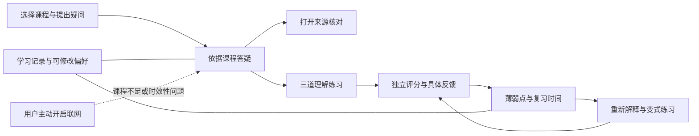
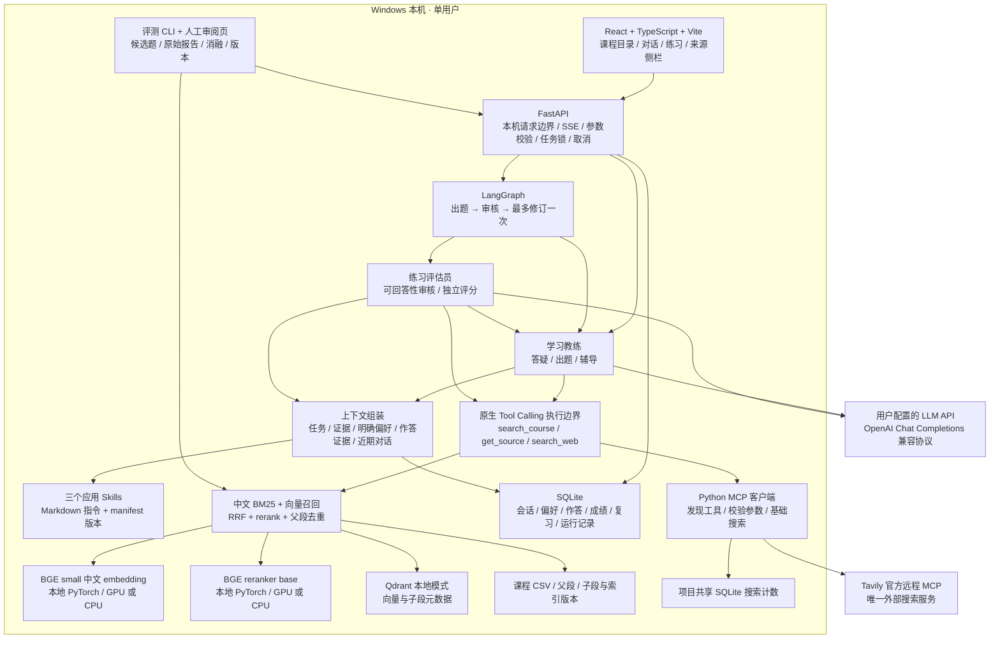
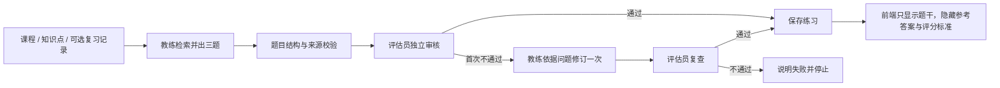

# 我如何组织课程智能学习助手的整体架构

整理日期：2026-10-25。代码基线：`1d5eaf1`。本文描述当前代码；[Dify 搭建教程](dify-build-guide.md)描述备选实现，两者的完成状态分开记录。

## 1. 产品架构：围绕三个学习任务

我服务的首要用户是正在学习 AI 产品经理课程的转岗学习者。产品目标是让学习者能回答“依据在哪里、我理解得怎样、接下来复习什么”。



| 产品模块 | 用户得到什么 | 不应被误解为 |
|---|---|---|
| 课程答疑 | 解释、比较、举例、连续追问及引用 | 任何问题都能回答的通用搜索助手 |
| 来源查看 | 整理文本、课程名、子主题、片段 ID | 视频定位或原讲义页码 |
| 理解练习 | 每轮三题，含简答与产品场景题 | 完整模拟面试或资格考试 |
| 评估反馈 | 三维分项评分、遗漏、误解、建议与依据 | 对个人能力的客观诊断 |
| 薄弱点复习 | 依据有效作答生成的复习队列 | 通过阅读时长推断的掌握概率 |
| 记忆管理 | 用户明确提供的偏好和学习证据 | 模型自行猜测的用户画像 |
| 联网补充 | 与课程资料明确区分的外部信息 | 自动补全课程库或替代课程评分依据 |

潜在付费方是课程机构，但机构减少答疑成本、学习效果提升及付费意愿仍属于待验证假设。

## 2. 技术总图



图中的上下文、检索、工具执行、存储和评测都是代码模块，不是新增 Agent。产品只有教练与评估员两个职责角色。

## 3. 各层的职责与代码位置

| 层 | 当前实现 | 主要位置 |
|---|---|---|
| 用户界面 | 工作台、主题、窄屏折叠、来源、练习与记录 | `frontend/src/App.tsx`、`frontend/src/api.ts` |
| API 与生命周期 | 请求校验、SSE、任务互斥、取消、成功后的事务写入 | `backend/main.py` |
| Agent 与流程 | 两个角色、工具收集证据、LangGraph 审核流程 | `backend/agents.py` |
| LLM 接入 | 原生工具调用、流式输出、结构校验、一次格式修复、Token | `backend/llm.py` |
| 请求及结果契约 | 题目、评分、工具参数与输入长度 | `backend/schemas.py` |
| 知识库与检索 | CSV 审计、切分、两路召回、融合、重排、引用还原 | `backend/knowledge.py` |
| 学习状态 | SQLite 事务、幂等提交、复习规则、删除后的上下文边界 | `backend/store.py` |
| 搜索 MCP | HTTP 传输的 MCP 初始化、工具发现和调用 | `backend/websearch.py` |
| 应用 Skills | 解释、三题练习、薄弱点复习 | `skills/explain/`、`skills/practice/`、`skills/review/` |
| 配置 | 模型、API、输出预算、推理强度、搜索上限与本地路径 | `backend/config.py`、`.env.example` |
| 自动评测 | 检索消融、问答检查、评分对照、断点与失败复测 | `backend/evaluation.py`、`backend/evaluation_jobs.py` |
| 人工审阅 | 候选来源检查、人工分数、本地版本化标注 | `backend/evaluation_review.py`、`frontend/public/evaluation.html` |

## 4. 知识库如何形成

```text
清洗汇总 CSV（当前 14 课、877 个父片段）
  → 检查字段、ID、异常文本与事务性内容
  → 保留原始父片段，生成可追溯的检索子片段
  → embedding 与 rerank 两个 tokenizer 分别检查长度
  → 约320 tokens 正文、约48 tokens 重叠，并保留父 ID 和字符偏移
  → 中文分词 BM25 索引 + 本地向量编码 + Qdrant
  → 保存课程、切分、模型及权重修订版本
```

当前私有数据得到2,243个子片段。原始课程不改写、不提交 Git。规则筛查只标记潜在转写、闲聊或事实时效问题，不证明文本已经语义正确。

检索时，关键词与向量各召回最多20条；RRF 按名次融合，取20条进入重排；最后按父片段去重，最多6个来源。辅助问题参与检索，不作为事实证据。来源正文可以展开，送入 LLM 的则是预算内摘录。

默认模型是 `BAAI/bge-small-zh-v1.5` 和 `BAAI/bge-reranker-base`。BGE base 是 embedding 对照项，尚无证据支持在本项目里替换 small。检索分值不展示为答案正确率。

## 5. 四条实际运行链路

### 5.1 一轮课程答疑

1. 前端发送问题、课程范围、会话 ID、Skill 与联网开关。
2. 后端验证参数和课程范围，建立运行记录。
3. 教练在第一次原生 `search_course` 调用中识别意图、改写指代；不清楚时先澄清。
4. 工具执行层固定课程范围，检索、重排并返回证据；模型无权自行扩大范围。
5. 用户开启联网且任务允许时，教练可以调用一次搜索工具；后端通过真实 MCP 访问 Tavily。
6. 后端组装当前 Skill、问题、实际读过的来源、明确偏好与最多六条近期消息。每条近期消息先限制长度，超预算继续裁剪。
7. LLM 流式回答；引用编号跨数据包时先缓存、验证后展示。外部来源最多占三个，总来源仍最多六个。
8. 生成成功且引用检查通过后保存回答；失败不保存为有效助手回复。提问不会更新掌握状态。

### 5.2 生成理解练习



### 5.3 提交与评分

1. 验证三题均有作答，题目编号匹配，单题不超过约定长度。
2. 评估员独立补充课程检索，只接收题目、标准、学生答案和证据；不接收教练对学习者的主观判断。
3. 每题按正确性、完整性、应用理由分别给0–2分，并返回已理解内容、遗漏、误解、建议与来源。
4. 后端检查成绩结构、题目集合与实际暴露的来源编号；教练根据已确定的成绩给辅导，不重新改分。
5. 有效结果完成后，后端事务性写入作答、评分与复习。重复提交返回原结果，失败不写入成绩。

### 5.4 复习与长期记忆

第一轮答对的知识点不会被自动加入薄弱点队列。错误会进入第一阶段，约1天后复习；已有薄弱点达到“总分至少5分且正确性2分”时，按阶段推进到约3天、7天；同一自然日不连续升级，答错回到短间隔。同轮同知识点按最弱的一题更新。

这些是透明规则，不是经过验证的个性化算法。用户可提前复习，不必等待后台定时任务。

## 6. 记忆、状态与安全边界

| 数据 | 保存及注入规则 |
|---|---|
| 当前会话 | 当前课程、问题与练习进度；近期消息按需取用 |
| 长期偏好 | 只保存用户明确提供的基础、目标、讲解偏好 |
| 学习证据 | 实际作答、有效评分、误解与复习时间 |
| 模型推断 | 不能冒充用户确认信息或已证实课程知识 |
| 删除或修改偏好 | 更新上下文边界，旧消息可查看但不再注入 |
| 清除学习记录 | 清除相应练习、复习与运行记录，不重置项目搜索预算 |

Agent 只能提出白名单工具调用。数据库写入由后端完成；没有任意 SQL、任意文件执行或外部网页指令修改系统规则的权限。应用仅用于本机单用户，不是公网认证系统。

## 7. MCP、Tool Calling 与 Skills 分别做什么

- **Tool Calling**：模型通过原生接口提出结构化工具请求，应用负责验证和执行。
- **MCP**：后端与 Tavily 工具服务之间真实发生初始化、发现工具、调用工具的协议。
- **Skills**：可版本化的教学指令，按任务加载。manifest 描述适用场景、输入输出与允许工具；实际权限仍由代码白名单控制。
- **Multi-Agent**：教练与评估员职责、提示词和上下文分离；并不预设同模型的两个角色就比单角色更准确。
- **Context Engineering**：控制给每个角色的任务、证据、历史、偏好、工具与预算，并记录版本。

每次回答最多一次基础搜索，最多返回5个网页结果；进入回答的网页来源最多三个。月度300次是项目请求上限，不是 Tavily 赠送的额度。搜索失败也占本地请求次数；外部资料不自动入课程库，不用于课程练习评分。

## 8. 评测与可观测性

我保留模型、提示词、Skill、知识库版本、耗时、Token、工具事件和角色交接。未配置单价时只报告 Token，不编造费用；模型内部思维链不展示、不作为学习记录保存。

自动测试检查功能、协议、事务和权限边界；检索消融检查各技术步骤的收益；人工标注判断事实支持与评分质量。人工审阅页的确认必须由实际审阅者完成。

当前37项测试与构建、CI通过；真实 LLM 和搜索 MCP 已接入。候选评测尚未获得完整独立人工 gold，时延仍有长尾，七天试用与商业价值也未验证。具体结果见 [验证记录](validation.md)。

## 9. 部署与公开交付

```text
本机 127.0.0.1:8765
  ├─ React 构建产物
  ├─ FastAPI 单进程（独占一个本地 Qdrant 索引）
  ├─ models/：模型权重
  ├─ runtime/：学习库、索引、报告、共享搜索预算
  └─ .env：LLM 与可选搜索密钥

GitHub
  └─ 代码、独立自编课程、公开评测候选、公开实验和产品决策文档
```

默认演示和真实模式、sample和private数据分别存储。模型、密钥、完整私有课程、衍生索引、个人记录与私有报告不发布。当前安装不依赖 Docker、Redis 或独立数据库服务；这是与 Dify 自托管方案的重要部署差异。

## 10. 面试中的一句话解释

我把课程学习拆成有依据的答疑、基于真实作答的评价和可追踪的复习，用两个有边界的角色处理语言任务，用确定性后端负责检索约束、引用、记忆与事务，并用实验而非架构复杂度证明技术取舍。
