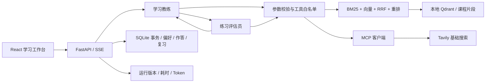

# 架构与接口

我把确定性的数据操作留在后端，把需要语言理解的部分交给有边界的 Agent。首版单用户、单后端进程、单次生成任务，所有服务仅绑定本机。

## 数据流

CSV 校验后保留父片段；按两种 tokenizer 的长度边界生成子片段。子片段具有父 ID、字符起止位置、所属课程与版本。向量编码用主题前缀＋正文，BM25 同时使用正文与辅助问题，最终事实来源始终是正文。

问题经过意图理解与指代改写，再由教练通过原生工具调用请求检索。应用固定课程范围，不能由模型扩大。关键词与向量各取20条，RRF选20条，rerank后按父片段去重最多6个。生成上下文只暴露实际选中的证据；返回编号必须在已读取来源集合内。

普通答疑把意图和指代改写合并进第一次 `search_course` 工具调用，避免再增加一个模型路由往返。流式输出在方括号跨数据包时暂存引用编号，验证后再展示；假引用被替换并使该轮失败，不保存为有效回答。拒绝请求中的假编号用普通文本呈现。

练习使用 LangGraph：出题→独立检查→通过，或出题→检查→修订一次→复查。失败后停止。提交作答后，评估员可独立补充课程检索，按三维评分，教练提供学习建议；数据库只在完整有效结果后写入。

复习按知识点合并。同一轮同一知识点取最弱的一题作为复习信号，防止最后一题答对覆盖前面的错误。同一天不连续升级。整体得分≥5且正确性满分可进入下一间隔；不将其宣称为客观掌握概率。

## 主要接口

| 方法与路由 | 用途 |
|---|---|
| GET /api/status、/api/courses | 配置状态、课程与数据版本 |
| GET /api/sources/{id} | 读取课程引用 |
| POST /api/chat | SSE 流：start、status、sources、delta、warning、done/error |
| GET/DELETE /api/sessions/{id} | 历史读取与删除 |
| POST /api/practices | 生成并审核三题；隐藏参考答案与 rubric |
| POST /api/practices/{id}/submit | 完整提交；幂等返回已完成结果 |
| GET /api/practices、/api/reviews | 历史练习与复习队列 |
| GET/PUT/DELETE /api/preferences | 用户明确提供的偏好 |
| DELETE /api/learning-records | 清除练习、复习和运行记录 |
| GET /api/traces | 本地调试与评测元信息 |
| GET /evaluation | 独立于学习流程的开发者人工审阅页 |
| GET /api/evaluation/sets、/runs | 候选集合和真实评测状态 |
| GET/PUT /api/evaluation/{name}/cases/{id} | 查看和人工标注，原数据保持不变 |

精确字段与校验见运行中的 `/docs`。接口要求 `X-Learning-Client: workbench`，变更请求校验 Origin，生产绑定本机；这不是公网认证方案。

修改或删除偏好、清空学习证据时会重置对话上下文边界。历史仍可查看，但旧消息不再注入后续模型请求，避免被删除的信息从以前的回答间接回流；需要承接的背景可重新说明。

## Context Engineering 与成本边界

系统规则、当前 Skill、当前问题、证据、明确偏好、相关学习证据、最近对话分别组织。上下文使用 UTF-8 字节数作保守上界估计，不声称等于服务商 token 数。先裁剪历史和每条证据摘录，仍超预算则停止并要求缩小问题。实际 usage 从服务商响应记录。

每次收集证据最多三轮，每轮最多四个工具调用；一次回答最多一次联网。MCP 工具发现后仅暴露基础搜索，关闭自动搜索参数升级。每个网络请求前原子预留月度额度，失败也计数。无密钥或超限不会改用付费服务。

实际搜索返回最多5条，进入回答上下文最多3条外部来源，并为课程来源保留位置。指定官网时可使用经过参数校验的 `include_domains`；MCP 未公布的参数不会发送。无法联网、服务限额或未实际搜索会显示未核查，服务商返回的升级指令不能改变权限。

出题和提交支持取消；本地请求保护使用纯 ASGI 中间件，避免遮住连接断开事件。真实 HTTP 断开回归验证后端停止在途生成、释放任务锁，不写入练习结果。结构化输出第一次不合格时，允许一次格式重生成；只反馈错误字段位置，不回灌模型原文或作答指令。失败与修复调用都记录 Token。

仅展示工具事件、来源、调用时延和 usage，不记录或展示模型内部思维链。模型原始服务错误不直接返回浏览器，避免回显密钥或请求头。

月度搜索计数使用独立的项目共享SQLite预算表，所有Agent实例共用，不随sample/private数据集或学习记录清空而重置。教练与评估员可使用同一API模型的不同推理力度配置；只给教练设置low时，评估员不会继承该覆盖。运行记录保留两类配置，以便对照质量、时延与Token。
