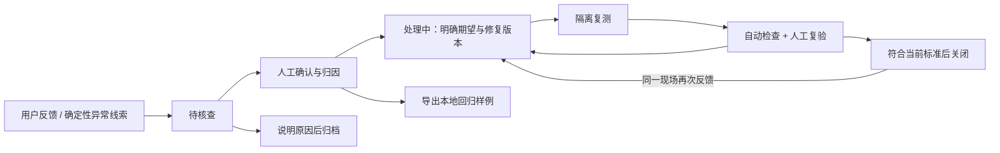

# 我如何把反馈变成可验证的改进

本次迭代为 **v1.1.0，2026-10-26**。我保留 v1.0 标签和冻结档案，在现有本机应用中增加质量处理流程：



## 用户价值与范围

我需要解决的不是单纯保存报错，而是学员对答案或评分有异议时，能够保留现场、定位问题、验证修复。新增入口包括回答下方的「反馈问题」、评分后的「评分有疑问」和侧栏「问题案例」。此页面面向个人内测和设计者复盘，不构建机构客服、团队工单或通用运维平台。

反馈描述、严重度、归因和模型检查都不是正确答案标签。只有实际审阅者明确确认后，案例才能由待核查进入已确认；我不会把自动测试中的 reviewer 测试字符串算作人工质量验收。

## 从一条反馈开始

1. 完成一次新的答疑或练习评分，再提交问题类型和可选说明。旧版本运行没有现场快照，会提示重新运行；不从残缺日志伪造历史现场。
2. 在「问题案例 → 核查与处理」查看反馈，选择严重度与归因，填写期望行为和可判定的验证标准。实际审阅者填写姓名并勾选人工核查。
3. 符合预期、信息不足等情况可以说明原因后归档。确认问题后进入处理中，记录修复提交或版本，再进入待验证。
4. 在「隔离复测」选择范围并发起一次任务。真实模式使用当前 `.env` 的模型参数，消耗 API Token；不发起新的联网搜索。失败、中断、取消也保留记录，不自动重试。
5. 实际审阅者对照期望行为、课程证据与复测输出，记录通过或不通过及依据。自动结构检查不能代替这一步。
6. 最新复测执行完成、结构与隔离检查通过、人工复验通过，且标准/归因/修复版本没有改变，才能在处理页关闭。数据、召回、排序问题必须用当前知识库复测。演示回放不能关闭真实模式的质量案例。

严重度：P0 表示信息或学习状态受损，P1 表示核心任务/质量问题，P2 表示一般体验问题。用户反馈默认 P2、运行失败默认 P1，仅用于初始排序；人工核查可以修改。归因覆盖数据、召回、排序、上下文、回答生成、练习评估、工具、运行环境和交互体验。

## 我保留哪些现场

SQLite 的 `traces` 扩展为含现场快照的运行记录；新增 `feedback` 保存报告，`badcases` 保存案例和处理/复测历史。启动时以 `CREATE TABLE IF NOT EXISTS` 增量建表，保留既有学习数据。API 对外的 `/api/traces` 仍仅返回元信息。

新快照记录：原始任务与必要会话、实际使用的偏好/学习证据、工具输入输出上下文、读取的证据、检索候选及排序次序、原始可见输出、数据版本、模型名及本地模型修订、提示词/Skill 版本、源文件指纹、耗时与 Token。LLM 调用上下文最多24次，来源池最多80条，检索记录最多12次；超过1MB时省略逐次 LLM 上下文，保留截断标记。复测入口拒绝超过1MB的现场，避免扩大请求。

我不保存 API 密钥、Authorization 或模型内部思维链；评分中的数值型 `reasoning` 是应用理由分项，仍保留。快照包含课程和作答，属于本机私有数据。未提交练习的原始出题结果、参考答案与上下文暂不开放，也不能复测、确认或导出。

精确重复的「运行ID + 类型 + 说明 + 来源」报告幂等返回；相同任务、配置、上下文、数据和程序版本的同类报告归到一个案例，累计报告数并保留运行ID。新会话ID或不同上下文可能形成不同案例；首版不做语义聚类，以免把不同原因混在一起。同一已关闭案例出现新报告，会重新进入处理中。

自动线索包括运行失败、引用编号被拦截/缺失、结构校验失败、工具拒绝和工具返回警告。正常取消不自动判作故障；未配置模型、无有效请求等前置校验错误不伪造可复测现场。语义答非所问、评分偏差、超时体验仍需用户反馈或 Evals 揭示。没有生产监控守护进程，也没有自动判断所有幻觉的能力。

## 两种复测不是同一种实验

| 模式 | 固定内容 | 重跑内容 | 适合的问题与限制 |
|---|---|---|---|
| 固定历史资料池 | 原请求、必要记忆、已捕获资料池 | 当前程序/提示词/Skill/模型重新调用工具并生成 | 比较生成和评分；从历史资料池按顺序提供资料，不运行 BM25、向量或 rerank，不能证明检索改进，也不保证逐轮工具路径相同 |
| 当前知识库 | 原请求与必要记忆 | 当前本地知识库检索、重排、生成/评分 | 检查检索与端到端修复；需要对应数据集，记录当前数据版本，资料变化可能影响比较 |

两种模式都建立临时 SQLite，历史偏好、必要对话与复习线索仅用于重建隔离上下文。它们共用现有两 Agent 与任务规则，不新增产品 Agent。临时库结束后清理；正式学习数据库的会话、成绩、偏好、复习记录前后摘要必须一致。当前知识库模式复用后端持有的 Qdrant 实例，不另开进程争抢索引。

评分复测固定原题、评分标准与学生答案。当前知识库模式会按原来源ID重新读取当前正文，再由评估员补充检索；原来源已删除则失败并提示先人工审核题目是否适用，不夹带旧正文作为当前证据。每次复测展示实际证据池、检索记录与提示词/Skill版本，便于比对资料变化。

历史网页只作为当时材料，不重新核实其时效性。外部 API 有随机性，即使配置相同也不保证完全一致输出。快照中的系统提示仅用于检查历史；复测由当前可信程序构造指令，不执行现场中的脚本或任意工具。

## 回归样例与 Evals 的关系

案例人工确认后，可导出 `course-assistant.badcase.v1` JSONL，包含期望行为、案例标准指纹、原始现场与输出，固定 `split=regression`。这是修复回归材料，不自动充当独立 gold，也不修改 `evals/test-lock.json` 或锁定测试集。公开仓库只发布自编数据与脱敏报告；完整课程及私人反馈不得提交。

下载后将私有文件放入被 Git 忽略的 `runtime/live-private/regressions/`，自编样例可放 `runtime/live-sample/regressions/`。从项目根目录执行：

```powershell
powershell -ExecutionPolicy Bypass -File scripts/eval-badcases.ps1 `
  -Dataset private -Cases "runtime/live-private/regressions/我的案例.jsonl" -MaxCases 1
```

或直接执行：

```powershell
.venv/Scripts/python.exe -m backend.cli badcase-eval --dataset private `
  --questions "runtime/live-private/regressions/我的案例.jsonl" --max-cases 1
```

批量入口默认只跑1条，最多20条，整个选中批次先校验再调用 API；只支持固定历史资料池。每次报告另存于对应 `runtime/.../reports/badcase-eval-*.json`，不会回写正式学习记录或自动关闭案例。状态 `completed_awaiting_human_review` 只表示执行结束，仍需人工比对期望。无 LLM 配置返回 `not_run`。从真实发现的案例构建回归集，可以防止旧问题复发；独立锁定测试集用于检验泛化，二者分别维护。

## 删除、费用与已知限制

- 修改/删除偏好时，关联快照、反馈说明、案例原输出、复测及处理上下文清除，案例归档且无法继续复测或导出；后续会话也沿用既有记忆边界规则。
- 删除会话时，关联答疑案例及反馈删除；清空学习记录会清除质量案例及运行记录。删除单个案例会清除其反馈/复测，但保留原始学习记录。
- **已下载的 JSONL 是独立副本，需要自行删除或替换。** 应用不会自动重新导入它，也无法远程撤回下载目录里的文件。手动用旧文件运行 CLI 会重新发送其中的上下文，应由文件持有者管理。
- 真实 API 调用可能计费；未配置单价时只报告 Token。不自动批量复测、不自动重新联网，不改变共享搜索预算。
- 重启中断的复测标记为 interrupted；相同 request_id 不重复消费，用户可明确发起新请求。网络取消不能撤销服务商已经处理的部分 Token。
- 当前人工归因、标准和复验由单个实际审阅者输入，无多人复核、工单负责人、SLA或跨案例语义合并。没有开发了流程就一定改善学习效果的结论。

接口字段以运行中的 `/docs` 为准。实现验证见 [本轮发布记录](releases/v1.1/README.md)。
