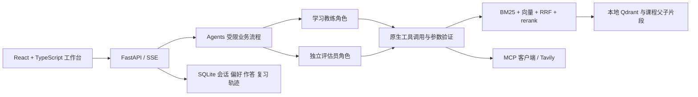
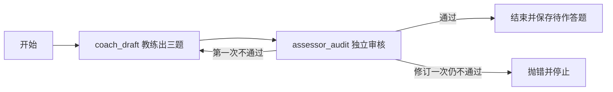

# 我的本地项目：架构与 Agent 实际逻辑

本文件按当前仓库源码及版本记录整理，关键实现全文在 05。它不读取当前 .env，因此下文默认模型来自 Settings 定义，不能代表电脑当下正在运行的配置。

## 用户与产品闭环

我聚焦 AI 产品经理转岗课程的学习者：课程概念难理解、难应用、不知道自己的误解，以及读过解释后缺少检验。流程是“有依据答疑→三题理解练习→独立反馈→根据真实错误复习”。课程机构是潜在付费方，付费与学习效果仍待验证。

Windows、RTX 5060 Ti 8GB、单用户本机运行；LLM 接兼容 API，本地 embedding/rerank 优先轻量中文模型。收费、多租户、机构后台、通用文件上传、语音、视频播放与完整模拟面试不在首版范围。

## 实际组件

- frontend/src/App.tsx：课程、答疑、来源、练习、复习、记录、设置等交互；可查看后端返回的结构化结果。
- backend/main.py：接口、课程范围验证、任务锁、取消、SSE、成功后写入与幂等。
- backend/agents.py：两个角色、证据收集、引用检查、出题审核图、评分与辅导。
- backend/llm.py：系统规则、LLM 协议、结构化输出、Skill 加载、预算与 usage 记录。
- backend/knowledge.py：语料审计、父子切分、本地模型、索引与混合检索。
- backend/store.py：SQLite 的偏好、会话、学习证据、复习状态和搜索预算。
- backend/websearch.py：真实 MCP 发现与白名单调用；不是普通 HTTP 搜索伪装 MCP。
- backend/schemas.py：Pydantic 请求、工具、题包、审核和评分协议。
- skills/explain、practice、review：应用内 SKILL.md＋manifest.json，带版本和工具约束。

## 两个角色是怎样实现的

源码使用一个 Agents 类承载多个方法；“两个 Agent”指职责、上下文、工具权限和角色事件的分离，不是必须有两个进程或两个 Python 类。可共用同一 LLM API 模型。普通问答只需教练；审题、评分时引入独立评估员。

| 角色 | 任务 | 看哪些输入 | 不做什么 |
|---|---|---|---|
| 学习教练 coach | 收集证据、解释概念、出三题、按评估结果辅导 | 当前任务、课程证据、必要偏好/近期对话/学习证据 | 不直接任意写数据库、不自行改变工具预算 |
| 评估员 assessor | 审核题目可答性、独立评分、必要课程检索 | 题目、标准、实际学生答案、相关课程证据 | 不接教练对学生的主观评价，不用外部网页判课程题 |

### 原生 Tool Calling：Agents.collect

1. 以 search_course、get_source 生成工具规格；仅教练在本轮明确允许联网时再开放 search_web。
2. 首轮通过 tool_choice 要求真实 search_course 调用。模型不返回 tool_calls 就报兼容错误，不假装检索成功。
3. SearchInput 同时带意图、独立查询、澄清信息。意图识别/追问改写合并进工具调用，避免额外一轮分类 LLM。
4. 工具参数经 Pydantic 验证；课程范围由后端 course_id 固定，模型不能扩大。get_source 也检查课程范围。
5. 最多 3 轮收集，每轮返回超过 4 个工具调用则拒绝；提示与 parallel_tool_calls=false 要求不并行。不能声称代码完全保证每轮只执行一次。
6. 每轮工具结果裁剪后回给模型；只将实际暴露的证据纳入后续可引用集合。较早大段结果改为简短说明。
7. 最终最多 6 个来源；外部资料最多 3 条，并为课程来源保留位置。本轮最多一次网络搜索。

### 课程答疑：Agents.chat 与 CitationGuard

加载当前 explain/review 等应用 Skill，取必要近期对话，先收集证据，再按上下文预算组织证据、偏好、学习证据和短历史。流式引用在方括号跨包时暂存，未知编号替换并让该轮失败，不保存有效回答。未提供行内引用会给出警告；编号存在仍不代表内容被证据支持。

### 出题：LangGraph 的有界协作

Agents.draft 只用实际课程片段生成 QuestionSet；至少含简答和产品场景题，检查题号唯一和来源白名单。audit 只看题目与引用的课程证据。after_audit 通过即结束，否则只允许一次业务修订。**业务修订次数**与 LLM.structured 对格式错误允许的一次重生成是不同上限。

前端 public_practice 隐藏参考答案、评分标准，提交后才显示。没有证据不出题。

### 评分、保存与复习

Agents.grade 检查三题答案完整，再以评估员角色独立收集课程证据，按 correctness、completeness、reasoning 各 0–2 分生成 GradeSet。检查题目一一对应、重复/缺失题号、引用是否在实际暴露证据内。双角色路径再交给教练给建议，不重新评分；单角色实验用于消融比较。

**本地 API 在 grade 成功返回完整结果后调用 Store.finish_practice。** 若生成辅导等步骤抛异常，完整结果未返回，则这次不写成绩；不要套用 Dify 的“先保存评分、辅导失败仍保留分数”顺序。

Store.finish_practice 使用事务与已提交结果判断保障幂等。同一知识点多题取最弱信号；correctness=2 且总分≥5 才作为通过。新知识点第一次全对不会凭空进入薄弱队列；出现错误从 1 天开始，已有主题通过后按 1/3/7 天推进，同日不连续升级。错误回到短间隔。这是透明产品规则，不是已验证的个性化算法或能力概率。

## RAG 与知识库

原始私有语料 14 节课、877 个父片段。父片段是引用单元；检索子片段记录 parent ID、字符起止位置、数据与模型版本。历史本地索引为 2,243 个子片段。切分检查 embedding 与 rerank 两类实际 tokenizer 长度，不能把 Dify 的字符上限等同本地 token 上限。

语义召回和中文分词 BM25 各取 20，RRF 合并前 20，rerank 再按父片段去重，最多 6 个来源。suitable_questions 可辅助召回，不能作为事实证据。后端/Qdrant 按 doc_id 过滤课程。模型与索引 revision 不符时不能继续使用旧索引。

Settings 默认 embedding 为 BAAI/bge-small-zh-v1.5，rerank 为 BAAI/bge-reranker-base；历史 small/base 对照不等于当前 Dify bge-m3 效果。GPU 实际验证过，但更换模型或环境后需另测。

## Memory 与 Context Engineering

SQLite 保存会话、明确偏好、实际作答与评分、复习时间等。问过、读过或说“懂了”不会自动记成掌握。删除偏好/学习证据会更新 context_boundary，旧历史可继续查看但不再进入后续模型上下文，防止信息回流；不是清空所有平台或 API 日志。

模型上下文按系统规则→当前 Skill/任务→相关证据→必要偏好/学习证据→近期对话组织。UTF-8 字节数用作保守上界，不声称是供应商精确 tokens。裁剪历史和证据仍超预算就停止；实际 usage 读服务商返回值。未配置单价不编造费用。

## MCP 与状态权限

WebSearch 通过 MCP 客户端发现 Tavily 工具、确认允许参数后执行基础搜索，最多返回 5 个结果。应用默认关闭联网；项目共享 SQLite 搜索预算每月 300 次，发送前原子预留，失败也计数，不随数据集切换或学习记录删除重置。300 次是我设置的本地保护上限，不是服务商赠送额度。

外部资料不自动写回课程，不用于首版课程练习评分。工具返回中的“升级”“换权限”等指令不能改变限制。Agent 没有任意数据库写权限；状态由后端根据有效结果完成事务写入。

## 当前证据范围

本地 v1.0 可进入个人内测，已有接口/GPU/MCP及部分问答、评分实验。完整人工 gold、事实支持率、评分一致性和目标时延尚未全部验收，存在明显长尾。详见 04；本包没有重新运行模型，也不把历史测试说成当前新默认模型的成绩。
