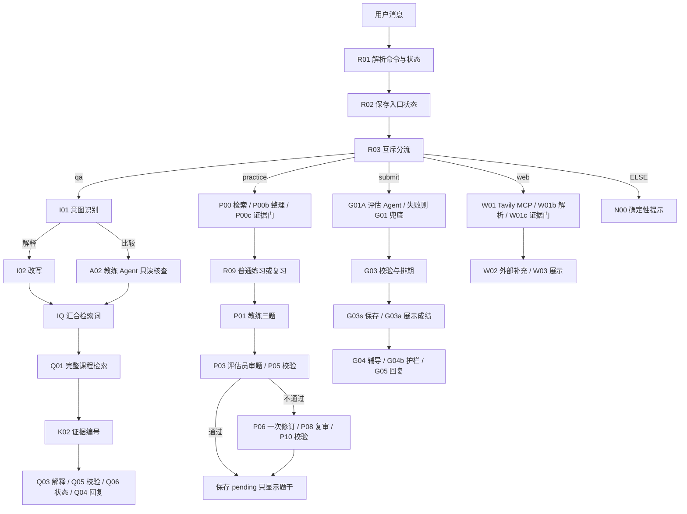

# Dify 复刻方案、与本地的映射及最新模型变更

## 当前最高优先级：2026-10-26 用户报告的新默认设置

| 项目 | 新工作空间默认值（用户截图） | 旧教学方案中显式绑定 |
|---|---|---|
| LLM | XingChenAGI/Xing4.0-29B | kimi-k3 |
| Embedding | BAAI/bge-m3 | qwen3.7-text-embedding-flash |
| Rerank | BAAI/bge-reranker-v2-m3 | 教学基线关闭模型 rerank，使用混合权重 |
| STT | FunAudioLLM/SenseVoiceSmall | 首版未启用 |
| TTS | qwen3-tts-flash | 首版未启用 |

证据仅为用户告知与提供的设置截图，没有重新进入工作空间核查或调用。这些是可见默认选择；供应商、服务端地址、权限、费用、上下文长度与原生 Tool Calling/结构化输出支持尚未核实，不能根据模型名称推断。

### 是否影响教程

核心业务流程、角色职责、代码与状态协议仍可沿用；**模型配置与验证步骤需要更新**，不应回答“完全没有影响”。

1. **默认不等于覆盖显式绑定。** 逐个查看 LLM、问题分类器、经典 Agent 的模型字段。如果仍选 kimi-k3，改变默认设置不能当作已经切换为 Xing4.0。仅在希望换模型的节点中显式选择新模型，或经确认使用共享模型变量。
2. **参数按新模型契约处理。** Kimi 不支持 temperature=0.7 是旧服务的实际失败，不是 Xing4.0 的限制。先保持非必要采样参数不传，再核对新服务支持；3000/5000 只是旧方案输出预算，不能保证适配新模型上限或推理行为。
3. **原生工具调用需要单独证据。** A02、G01A 采用 FunctionCalling。若新模型/插件不支持，先解释这一限制，不把 ReAct 或固定工具节点冒充原生 Tool Calling 已通过。可以先搭固定检索基线，后续再选择支持模型并最小验证。
4. **结构化输出仍要验证。** P01/P03/P06/P08/G01 依赖 Schema；模型不原生支持时，Dify 的提示词约束不保证格式正确，代码校验必须保留。G01A 最终 text 也必须是符合协议的 JSON。
5. **Embedding 必须与库索引一致。** 老完整库曾用 qwen3.7-text-embedding-flash 实际索引为 877 个可用父段。默认 bge-m3 不代表这套库已迁移；如要改用 bge-m3，需要在目标知识库确认模型并完成重新向量化，或建立明确命名的新版本库。不能用一个模型的 query 向量检索另一个模型的旧向量，即使维度碰巧相同也不行。
6. **三个检索入口要一致。** Q01、P00、只读 Workflow 的 TQ 都选择同一个目标库；库级与节点级召回一起核对。旧参数 JSON 的 weighted_score.vector_setting 也可能仍写旧模型，手工搭建通过当前 UI 重新保存，不盲抄旧内部字段。
7. **配置了 rerank 默认值不等于启用。** 维持语义 0.7/关键词 0.3、Top K=6 的无模型 rerank 基线仍符合当前约定；用户允许没有 rerank 就不用。若主动启用 bge-reranker-v2-m3，需在库级、节点级实际选模型，另做质量/时延/费用比较，不能把旧基线的结果归给新模型。
8. **语音默认值不启用语音功能。** 教程首版仍关闭语音输入输出。更换模型也不会自动改变本地 .env 或 BGE 模型目录。

官方说明入口：[LLM 节点](https://docs.dify.ai/zh/cloud/use-dify/nodes/llm)、[知识检索的库级与节点级设置](https://docs.dify.ai/zh/cloud/use-dify/nodes/knowledge-retrieval)、[经典 Agent](https://docs.dify.ai/zh/cloud/use-dify/nodes/agent)。本表是按现有配置与向量检索契约进行的迁移判断，不是新模型实测报告。

## Dify 产品主线

经典 Chatflow：主流程 64 个节点、79 条连线。只读课程检索工具：另一个 Workflow，4 节点、3 连线。只有教练和评估员两种角色。LLM 节点数不等于 Agent 数，代码、条件分支和直接回复也不算 Agent。

上图是概念主线，不代替逐条连线表。03 保存所有实际连接，包括澄清、无证据、评分失败、一次修订停止和异常出口。

## 本地与 Dify 的对应关系

| 能力/本地实现 | Dify 节点或实现 | 关键差异 |
|---|---|---|
| 前端明确入口、后端请求校验 | START→R01→R02→R03 | Dify 以 /练习、/作答 等命令替代专用表单；不是原 React 工作台 |
| collect 中的意图识别和检索改写 | I01 分类器、I02 改写；比较路径 A02→A02b→IQ | Dify 拆成额外模型调用，不能沿用本地时延 |
| search_course 的固定课程范围 | Q01、P00、TQ 检索完整库 | 单列 CSV 合成一个文档后无严格单课 metadata 筛选；课程编号正文不是过滤器 |
| 本地 BM25＋向量＋RRF＋rerank | Dify 高质量混合权重基线 | 排序算法、tokenizer、索引和模型不同，不能称作 RRF 精确复现 |
| 父片段与实际暴露证据 | K02/P00b/TK，原文含来源编号 | 需核对父子召回的返回正文是否保留 ID；同一个文档引用卡不等于同一片段 |
| explain Skill 与 chat | Q03、Q05、Q06、Q04 | Q05 只查已写编号是否合法，不强制每项事实都有引用，仍需人工核验 |
| LangGraph draft→audit→最多修订一次 | P01→P03→P05；失败 P06→P08→P10 | 代码校验和保存独立于 LLM；最多一次业务修订，没有无限循环 |
| 独立评估员 collect＋GradeSet | G01A→G02A/G02b，格式失败 G01；G03 校验 | 固定 structured 兜底仍是评估员角色，不是第三个 Agent |
| 后端完整结果后事务提交 | G03s 在 G04 辅导之前写入会话状态 | **保存顺序不一致**：Dify 辅导失败时已保存成绩；本地 grade 未完整返回则不保存 |
| SQLite 长期偏好、答案、复习 | conversation.learning_state 字符串 | 只在同一聊天多轮保留，不保证跨聊天档案；没有本地事务/用户记录管理的完整能力 |
| review Skill＋作答证据 | R01 的 /复习→R09→R10→P01 | 用户主动查到期主题，不自动推送；间隔规则代码可能与本地实现细节不同，以各自源码为准 |
| 三个版本化应用 Skill | 对应 Q03、P01、R10 等分支中的指令 | 不是 New Agent 的原生 Skills 发现和加载运行时 |
| 原生 Tool Calling 工具权限 | A02、G01A 两个经典 FunctionCalling 节点 | 只开放只读 search_course；工具实际调用要看运行轨迹 |
| Tavily 官方 MCP | W01 原生 MCP 节点 | 只有 /联网 路径；明确标为外部资料，不参与课程评分 |
| 项目共享 SQLite 全局月上限 300 | R01 每会话最多 10 次搜索尝试 | 后者不能替代全局、并发安全、跨会话的月预算 |
| 来源侧栏、跨会话 CRUD、评测 UI | Dify 自带 Web App、运行详情、手工评测卡 | 无完整本地 UI 和后端管理能力的等价复现 |

## 只读 Workflow 工具

TS（必填 query String）→TQ（目标完整库检索）→TK（evidence.py 整理）→TE（输出 evidence、source_ids）。发布为工作流工具 search_course，供 A02/G01A 使用。它是内部 Workflow 工具，**不是 MCP**；Tavily 才是外部 MCP。只读工具不具备任意数据库写入能力，独立 Web App 不应直接公开私人课程。

## 上下文与学习证据

learning_state 的初始值 {}、类型 String。R01 解析后只把必要偏好、近期 6 轮受限历史、当前题干与相关误解交给适用节点。删除偏好同时清理近期上下文；不能解释成平台日志全删除。评估员输入限定在题包、标准、答案与课程证据，不接受教练对学生的评价。

提示词中 {{#R01.context#}} 是教程表达式。复制后必须用自己 Dify 的变量选择器绑定；节点标题 Q03 与内部唯一 ID 不是同一回事。对象输出 structured_output 需经过 P02/P04 等序列化后才是 JSON 字符串；下游类型不能混用。

## 验证边界

旧 qwen3.7 完整库索引与混合检索曾通过；旧 Kimi 的一次问答流程到最终回复，但因输出预算不足被截断，不能算有依据回答质量通过。最终增大预算修正版没有继续导入/试跑。练习、评分、复习、Agent 工具轨迹与联网整链路仍需逐支验收。

**最新默认模型组合尚无真实调用与质量证据。** 先核对显式绑定和索引，再由用户选择一次最小实际验证；不能把历史 Kimi/qwen 的耗时、成功或失败嫁接到 Xing/bge-m3 上。
