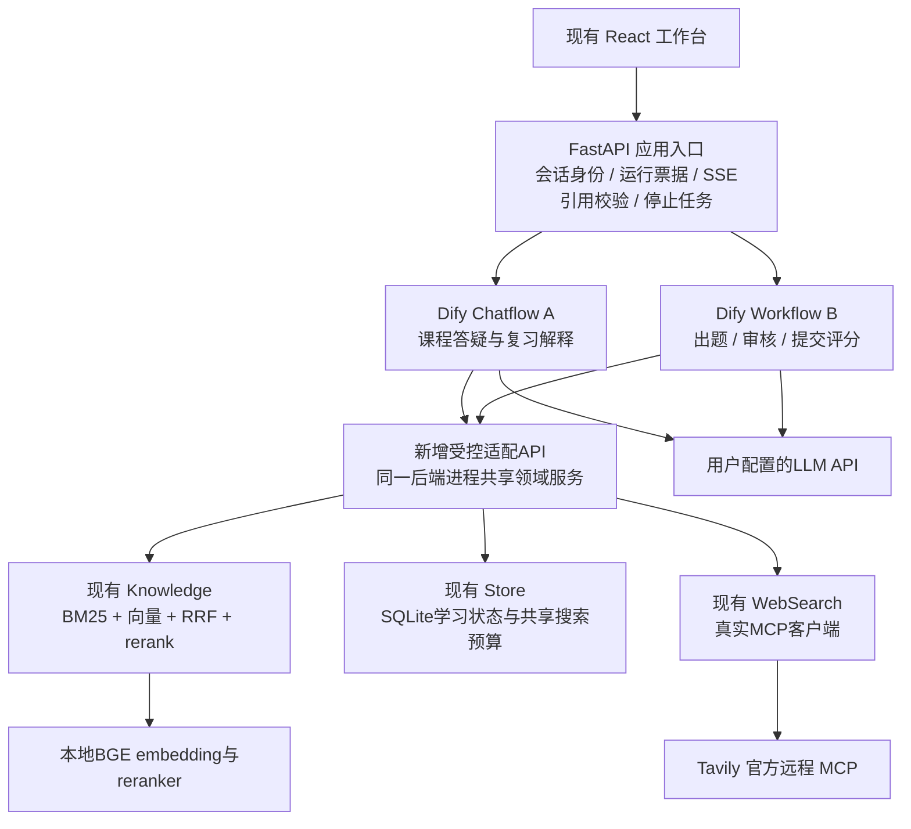
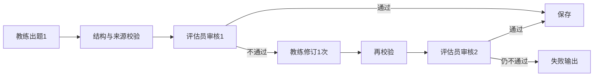

# 我如何用 Dify 搭建同一款课程智能学习助手

核查日期：2026-10-25。Dify 参考版本：**1.18.0**，官方于2026-10-23发布。现有产品架构见 [整体架构](architecture-overview.md)。

**交付状态：这是一份迁移设计和逐步搭建教程，包含接口契约、提示词、Schema及参考代码。当前产品仍运行原有 React + FastAPI + LangGraph 实现；本文未部署 Dify，未实现下文新增的 `/bridge/*` 接口，也未完成 Dify 端到端验收。**

我以官方文档和1.18.0发布源码核对功能，界面名称以目标实例为准。文中的节点名称是我建议的画布标签，不是 Dify 自动生成的节点 ID；变量应通过界面的选择器插入。[版本来源](https://github.com/langgenius/dify/releases/tag/1.18.0)。

## 一、先决定 Dify 在产品中负责什么

### 方案比较

| 选择 | Dify 负责 | 仍需要什么 | 主要取舍 |
|---|---|---|---|
| 保持当前代码版 | 不接入 | 当前代码与本地模型 | 部署最轻、流程与实验控制直接；改提示词与流程需改文件 |
| **推荐：Dify 编排＋本地领域服务** | Chatflow、练习Workflow、模型节点、可视化调试 | React、检索、模型、记忆、权限、事务、评测及一层适配API | 能尽量保留现有行为；需要适配开发，并增加Dify基础设施 |
| 更多使用 Dify 原生能力 | 内置知识库、Agent、流程、标准Web App | 至少还需长期学习状态和可靠成绩写入；本地模型服务 | 画布原型容易，但不等同于现有切分、召回、引用和完整学习工作台 |

**我不把整个 FastAPI 后端原样包进一个 HTTP 节点称为“用 Dify 重建”。** 推荐方案中，实际的语言流程移到 Dify；Python 只保留确定性的检索、授权、预算、校验与数据操作。

### 推荐架构



我只创建两个 Dify 应用：一个对话应用、一个无会话的练习工作流。应用数量不是 Agent 数量；角色仍然只有学习教练与练习评估员。某一角色的检索、出题、重写、反馈可分布在多个节点，不为每个节点新建角色。[Chatflow与Workflow区别](https://github.com/langgenius/dify-docs/blob/main/en/self-host/use-dify/build/workflow-chatflow.mdx)。

### 当前能力迁移对应

| 当前能力 | 推荐方案中的位置 |
|---|---|
| 原有 LangGraph 出题审核流程 | Dify Workflow 的明确分支和最多一次修订 |
| 普通答疑收集证据 | 经典 Agent 节点，使用 Function Calling |
| 三题与结构化评分 | LLM 节点＋JSON Schema＋后端验证 |
| 混合检索与重排 | 本地 Knowledge 服务，通过只读工具调用 |
| 三个 Skills | 后端按任务加载版本化指令；新版原生Skills作为可选路线 |
| 学习记忆与复习规则 | SQLite领域服务；不靠对话变量代替长期证据 |
| MCP | 推荐路线在本地搜索工具背后；可选路线由Dify原生MCP连接 |
| 来源展开与流式引用拦截 | 原React界面＋FastAPI转发层 |
| Evals | 现有独立评测工具，增加Dify调用适配，重跑同一批题 |

## 二、准备与安装：步骤1—6

### 第1步：准备隔离目录和记录版本

从项目根目录操作，计划使用：

```text
runtime/dify/source/       Dify 1.18.0源码及其docker目录、卷和.env（Git忽略）
runtime/dify/evaluations/  Dify试验原始记录（Git忽略）
docs/dify/                我编写的契约、提示词、示例（可公开）
```

另记录插件版本、Dify发布版本、目标流程版本、LLM模型与参数、课程版本、embedding和rerank修订号。暂时保留原代码版作为对照与回退路径。

### 第2步：准备 Windows / WSL2 / Docker

1. 按[Docker官方Windows安装说明](https://docs.docker.com/desktop/setup/install/windows-install/)准备Docker Desktop与WSL2。
2. 在Docker Desktop中使用Linux容器后端。
3. 在PowerShell检查：

```powershell
wsl --status
docker version
docker compose version
```

官方Dify最低条件是2核、4GiB内存；这不代表加上本地模型、浏览器和开发工具后仍满足本项目性能。本教程的端口覆盖模板使用 `!override`，因此要求Compose **2.24.4及以上**。安装后检查实际可用内存，不同时加载两份相同模型作日常运行。[Dify部署说明](https://github.com/langgenius/dify-docs/blob/main/en/self-host/deploy/quick-start/docker-compose.mdx)、[Compose合并规则](https://docs.docker.com/reference/compose-file/merge/)。

Docker/WSL镜像存储可以尽量放D盘。官方建议Linux容器绑定的数据放在Linux文件系统；下面集中在项目D盘的路径便于管理，但可能增加文件读写开销。若改用WSL Linux路径，应同步调整后续目录，并把公开配置和导出包归档回本项目。

### 第3步：下载明确版本，不跟随未知的 main

首次执行，目录必须尚不存在：

```powershell
New-Item -ItemType Directory -Force runtime/dify | Out-Null
if (Test-Path -LiteralPath runtime/dify/source) { throw '目标源码目录已存在，请保留已有配置，不要重复初始化。' }
git clone --depth 1 --branch 1.18.0 https://github.com/langgenius/dify.git runtime/dify/source
if ($LASTEXITCODE -ne 0) { throw '下载未完成，请先解决网络或Git错误。' }
Copy-Item runtime/dify/source/docker/.env.example runtime/dify/source/docker/.env
```

这是Dify自己的环境配置，不是项目根目录已填写的LLM `.env`。不要互相覆盖。

### 第4步：仅在第一次启动前初始化部署密钥

本教程附带 [初始化示例](dify/examples/bootstrap_env.py)，根据1.18.0模板生成随机部署密钥，不输出值；保持数据库、Redis、插件、沙箱、Agent组件之间引用一致。

```powershell
.venv/Scripts/python.exe docs/dify/examples/bootstrap_env.py
```

它只用于全新配置。已有初始化标记或数据卷时会拒绝执行；已有部署应保留原密钥，不能为了“重装配置”随意旋转数据库或加密密钥。Dify1.18.0启动还需要新版Agent相关组件的配置，即使主教程使用经典节点，也不能照搬旧版少服务的Compose示例。[对应模板源码](https://github.com/langgenius/dify/blob/1.18.0/docker/.env.example)。

其中Agent Server根密钥要求解码后恰好32字节的无填充base64url字符串，示例脚本已单独处理；不能用任意长度普通字符串替代。[官方环境参数](https://github.com/langgenius/dify-docs/blob/main/en/self-host/deploy/configuration/environments.mdx)。

### 第5步：使用本机端口并启动

```powershell
Copy-Item docs/dify/docker-compose.local.example.yaml runtime/dify/source/docker/compose.local.yaml
Push-Location runtime/dify/source/docker
try {
    docker compose -f docker-compose.yaml -f compose.local.yaml config --quiet
    if ($LASTEXITCODE -ne 0) { throw 'Compose配置检查失败，请先修复，不继续启动。' }
    docker compose -f docker-compose.yaml -f compose.local.yaml up -d
    if ($LASTEXITCODE -ne 0) { throw 'Dify未启动成功，请检查报错。' }
    docker compose -f docker-compose.yaml -f compose.local.yaml ps
} finally { Pop-Location }
```

覆盖模板把Web入口绑定到 `127.0.0.1:8088`，HTTPS端口预留为本机8448，未配置证书时不使用；关闭不需要的插件远程调试端口映射。`config --quiet`检查配置且避免把合并后的敏感值打印出来。

Dify有自身PostgreSQL、Redis、插件进程和其他依赖；这与原产品的单Python进程不同。默认向量组件属于Dify自身基础设施，不要把现有Qdrant本地目录挂给另一个进程共用。

### 第6步：创建管理员并核对健康状态

打开 `http://127.0.0.1:8088/install` 完成管理员初始化，再登录工作区。确认核心服务正常，首次初始化权限任务正常退出可以接受。先用自编课程测试，完整私有课程、日志和Dify数据卷仍放本地。

**这一阶段通过条件：**控制台可登录，插件页面可打开，无反复重启的核心服务。仅容器显示运行还不能证明模型、工具与学习流程可用。

## 三、实现可连接的本地服务：步骤7—11

### 第7步：先补适配API，再拖完整业务流程

下表的 `/bridge/*` **均为新增设计，现有后端没有这些路由**。必须先实现并通过独立检查；不能拿现有 `/api/chat` 或 `/api/practices` 当等价替代，因为它们内部已经会运行原Agent与LLM。

逐接口请求、响应、运行状态和事务要求见 [适配层合同](dify/bridge-contract.md)。这一部分属于必要的Python适配开发，不是单纯画布操作。

| 新接口 | 调用者与权限 | 复用或新增逻辑 |
|---|---|---|
| `GET /bridge/health` | 网络检查，不返回敏感数据 | 新增健康检查 |
| `POST /bridge/context` | 固定HTTP节点 | 根据短期run_ticket返回当前任务和必要记忆；新增票据检查 |
| `POST /bridge/tools/search-course` | 教练/评估员只读工具 | `Knowledge.search`；课程范围从票据读取，不让模型指定 |
| `POST /bridge/tools/get-source` | 教练/评估员只读工具 | `Corpus.source`；补课程范围检查与摘录登记 |
| `POST /bridge/tools/search-web` | 仅允许联网的教练运行 | `WebSearch.search`真实MCP；补每运行一次上限 |
| `POST /bridge/evidence/finalize` | 固定HTTP节点 | 从服务端本轮读取记录组装最多6个来源，不信任Agent自报ID |
| `POST /bridge/practices/validate` | 固定HTTP节点 | 当前QuestionSet及题号、题型、来源校验；不写学习成绩 |
| `POST /bridge/practices/save` | 审核通过后的固定HTTP节点 | `Store.add_practice`；新增运行级幂等与隐藏参考答案 |
| `POST /bridge/grades/validate` | 固定HTTP节点 | 当前GradeSet、题号、分值、实际暴露证据；生成短期校验回执 |
| `POST /bridge/grades/commit` | 固定HTTP节点 | 复查回执及活动状态，调用`Store.finish_practice`事务写入 |

准备一个同进程的领域服务对象，共享Knowledge、Store、搜索预算和任务状态。当前Qdrant是本地模式，不能让原服务与另一个新进程同时打开同一个索引目录。迁移联调时由一个进程持有，或使用独立只读快照作隔离试验。

Agent工具注册只包含三个只读/搜索接口，**不包含 save、commit、任意HTTP请求或SQL**。确定性HTTP节点可以写状态，模型不能选择这些写接口作为工具。

### 第8步：新增运行票据和证据记录

前端先调用FastAPI。FastAPI验证单用户身份、课程范围、联网开关和任务，创建短期随机 `run_ticket`，再把票据交给Dify。模型不负责创建票据。

票据在服务端绑定：

```text
run_id、user_id、action、course_id、web_enabled、practice_id
memory_version、知识库版本、活动/取消状态、到期时间
工具调用计数、本轮是否已尝试联网、幂等操作结果
```

再为工具返回的每份摘录登记来源ID、版本、实际返回文本或其摘要标识。引用验证使用这份真实读取记录，不能使用模型“声称已经检索”的列表。

HTTP上下文响应统一为：

```json
{
  "ok": true,
  "context": {
    "action": "chat",
    "question": "RAG是什么？",
    "course_id": "01",
    "skill_name": "explain",
    "skill_version": "1.0.1",
    "skill_instructions": "这里由服务端读取技能正文",
    "preferences": {},
    "recent_dialogue": [],
    "learning_evidence": []
  }
}
```

这是自编数据示例。出题、提交、复习时由服务端返回不同的最小上下文；评分上下文不带教练对学生的判断。修改偏好后更新memory_version，使旧票据失效。

### 第9步：打通 Docker 到 Windows 服务的网络

有三个不同的地址空间：浏览器的127.0.0.1、Windows主机、Dify容器。**容器内的127.0.0.1不是Windows主机。** Dify Cloud也无法直接访问本机127.0.0.1。

1. 保持原工作台入口 `127.0.0.1:8765`。
2. 给同一领域进程新增专用适配入口，例如8770；只提供bridge路由，强制Bearer鉴权。
3. 让适配入口监听容器实际可达的主机私有接口。Docker Desktop常用名称是 `host.docker.internal`，但服务仅绑定127.0.0.1时不保证可达，需要实测。
4. 将8770的入站规则限定为需要的Docker/WSL网络；不要把既有8765主应用改为向整个局域网开放。
5. 新适配入口的Host白名单与Origin规则单独配置；现有`TrustedHostMiddleware`不会自动接受新主机名。
6. 先在Dify的HTTP Request节点请求 `http://host.docker.internal:8770/bridge/health`；如果使用指定私有IP，则统一替换本教程BASE_URL。
7. 只有健康检查成功后再测试Bearer及课程检索。连接拒绝通常查监听接口、防火墙、端口；403查票据、令牌、Host和代理策略。

适配入口必须由开发者实现和限定网络边界，这一步不是增加一个HTTP节点就会自动完成的。当前教程没有运行任何监听端口或修改防火墙。

### 第10步：保留SSRF代理并精确允许目标服务

Dify部分外部请求通过SSRF代理，Docker能解析主机名仍可能被代理拒绝。按目标版本的代理配置为专用适配主机及端口设置有限例外，保留其他私网保护，不全局放开所有私网。

1. 检查1.18.0的 `docker/ssrf_proxy/squid.conf.template` 和 `squid-common.conf.template`。
2. 为专用适配目标添加精确ACL，并在拒绝私网的规则之前允许该目标；规则同时限制目的地址/域名、服务端口和所需调用来源。
3. 重启相关代理，再在HTTP Request节点验证。
4. MCP请求可能来自插件或Agent相关进程，需逐一路径验证，不以一个浏览器curl成功代替全部路径。

官方的外部知识连接文档提供了代理排障入口；具体规则要按部署网络生成，不能直接复制一个未知私网段。[官方连接与排障](https://github.com/langgenius/dify-docs/blob/main/en/self-host/use-dify/knowledge/connect-external-knowledge-base.mdx)。

### 第11步：导入三个只读工具

1. 打开 **Integrations → Tools → Swagger API**。
2. 导入 [bridge-openapi.yaml](dify/bridge-openapi.yaml)。其中8770地址是待实现的服务地址。
3. 配置Bearer凭据，使用新的适配工具令牌，不使用LLM Key或Tavily Key。
4. 单独测试 `search_course`、`get_source`、`search_web`。
5. 检查跨课程来源被拒绝，空查询和超长查询被拒绝；关闭联网的票据不能搜索。
6. 在Agent节点中，把 `run_ticket` 配置为**手动绑定上游变量**；query、intent等才允许模型生成。

字段隐藏或手动绑定不能代替服务端授权。写状态接口只通过固定HTTP节点访问，使用独立的流程服务凭据。自定义工具与原生MCP的区别见后文步骤31。[官方工具类型](https://github.com/langgenius/dify-docs/blob/main/en/self-host/use-dify/workspace/tools.mdx)。

## 四、配置模型和共用约束：步骤12—14

### 第12步：配置LLM提供商

1. 打开 **Integrations → Model Provider**。
2. 安装目标服务对应的官方模型插件；如果使用兼容OpenAI协议的插件，确认支持自定义Base URL和模型名。
3. 在插件凭据界面填写本地 `.env` 中同一服务的地址、模型名和Key。Dify不会自动读取项目根目录这些变量。
4. 测试普通输出、原生Function Calling、流式输出和结构化结果。
5. 当前模型是 `kimi-k3`。温度能不发送就不发送；插件强制要求时，根据服务支持值配置，不能照搬0.2。
6. 教练可试用low推理强度，评估员保持服务默认；插件没有对应参数时，需要模型插件或请求适配，不能把`reasoning_effort=low`写进提示词就宣称生效。
7. 验证工具续轮是否保留该服务需要的附加消息字段，例如Kimi的`reasoning_content`；不要把内部思考文本显示给学习者。

先建立两套节点模型配置：`coach_model`与`assessor_model`，它们可以指向同一个API模型、采用不同参数。上下文初始预算参考当前32768；普通回答输出上限1800，结构化任务参考6000，请求超时参考120秒。它们是当前接入参数，不是速度承诺。模型参数兼容性必须在Dify再验证，代码版通过不代表插件自动通过。[模型提供商](https://github.com/langgenius/dify-docs/blob/main/en/self-host/use-dify/workspace/model-providers.mdx)。

### 第13步：配置流程环境变量

在两个应用中建立：

| 名称 | 类型/用途 | 是否交给模型 |
|---|---|---|
| `BRIDGE_BASE_URL` | 服务地址，例如已验证可达的8770入口 | 仅固定HTTP节点使用 |
| `BRIDGE_FLOW_TOKEN` | Secret，固定流程节点鉴权 | 不写入提示词 |
| 工具Bearer凭据 | 在Tools中保存，三个工具专用 | 不写入提示词 |
| `PROMPT_VERSION` | 文本，例如dify-0.1.0 | 可用于运行元信息 |
| `coach_model` / `assessor_model` | 支持时用LLM类型变量，共享模型配置 | 仅模型配置 |

运行票据放在每次服务API请求的inputs中，不放URL、不放固定示例，不使用长期Secret代替票据。普通用户不直接持有Dify Service API Key。

### 第14步：准备技能和Schema

1. 使用现有 `skills/explain`、`skills/practice`、`skills/review`，由适配上下文按任务返回内容与版本。
2. 共同系统约束和各角色提示词见 [提示词手册](dify/prompts.md)。
3. 出题节点的结构化输出使用 [QuestionSet.json](dify/schemas/QuestionSet.json)。
4. 审核节点使用 [AuditResult.json](dify/schemas/AuditResult.json)。
5. 评分节点使用 [GradeSet.json](dify/schemas/GradeSet.json)。
6. 确认模型插件实际执行结构化输出；不支持原生JSON约束时仍需要后端验证。

这些Schema从当前产品代码导出。Schema能检查结构，但不能证明课程事实正确或题目具有教学价值。若Dify编辑器不接受某个Schema关键字，保留兼容的生成约束，把完整校验留在后端。[LLM结构化输出](https://github.com/langgenius/dify-docs/blob/main/en/self-host/use-dify/nodes/llm.mdx)。

## 五、搭建答疑Chatflow：步骤15—20

### 第15步：创建应用A和输入变量

在Studio中新建 **Chatflow**，名称“课程学习—答疑”。User Input节点保留系统问题变量，新增 `run_ticket` 短文本。票据由后端通过服务API传入；不要将它当作用户手动填写的学习问卷。

1. 课程选择、联网开关、用户身份由原工作台和后端管理。
2. Dify对话变量只可保存非权威的界面状态，不保存正确知识或成绩。
3. 本路线关闭LLM Memory和Agent自动Memory，显式使用后端返回、经过删除边界处理的近期消息。
4. 在当前版本选择器中通常看到 `userinput.query`；旧版可能是 `sys.query`。使用界面实际提供的变量，避免手敲旧名称。

### 第16步：添加上下文读取与解析

添加HTTP Request节点“Q01 读取任务”：

```text
POST  BRIDGE_BASE_URL + /bridge/context
Authorization: Bearer BRIDGE_FLOW_TOKEN（Secret变量）
Content-Type: application/json
Body: {"run_ticket": 上游票据变量}
```

请求体用界面变量插入或由Code节点 `json.dumps` 构建；不要用未经转义的用户答案拼接JSON。错误分支返回“本次任务上下文不可用”，不继续调用模型。

添加Code节点“Q02 解析上下文”，输入body绑定HTTP响应正文，粘贴 [parse_context.py](dify/examples/parse_context.py)。输出 `context_json` 为String。评分上下文、完整课程和全部历史不应被一起传入这个节点。

### 第17步：添加教练Agent收集证据

添加**经典Agent节点**“Q03 教练收集依据”：

| 配置项 | 配置 |
|---|---|
| 策略 | Function Calling；不要用文本ReAct伪装原生工具调用 |
| 模型 | coach_model |
| Query | 当前问题与受控context_json |
| 最大迭代 | 先从3开始，查看轨迹是否能完成；不等同于工具请求硬上限 |
| Memory | 关闭，使用显式上下文 |
| 工具 | search_course、get_source；仅联网允许分支增加search_web |
| 指令 | 只做意图识别、必要澄清与证据收集，不把其自由文本当正式答案或证据清单 |

在联网允许与关闭两个分支中分别配置工具集。即使画布误配，后端票据也必须拒绝未授权搜索。普通问题先调用search_course；无关或不清楚的问题可以明确澄清。

Dify节点的迭代次数和当前代码“最多三轮，每轮最多四个调用”不是同一个计数口径；迁移后记录实际工具调用，并由适配层额外限制搜索次数，不能只凭界面参数认为等价。[经典Agent配置](https://github.com/langgenius/dify-docs/blob/main/en/self-host/use-dify/nodes/agent.mdx)。

### 第18步：从后端取回实际证据

在Agent后添加HTTP Request节点“Q04 固化依据”，调用 `/bridge/evidence/finalize`，传入run_ticket。

服务端根据实际工具读取记录：

1. 取最多6个来源，网页最多3个。
2. 记录来源ID、课程版本、摘录与外部URL。
3. 打包预算内的上下文；保留完整原文供侧栏读取。
4. 返回decision：`answer`、`clarify`或`insufficient`，以及明确的联网失败提示。

使用IF/ELSE分支：clarify返回服务端清理过的澄清；insufficient返回证据不足；answer才进入解释节点。这样不需要解析Agent自由文本猜测它是否真的读过资料。

### 第19步：添加正式讲解与回答

添加LLM节点“Q05 教练讲解”：使用explain或review Skill、当前问题、后端明确偏好、必要历史及Q04真实证据，使用教练模型，Memory保持关闭。提示词要求课程与外部信息分开、只引用已有ID、没有证据则说明不足。

连接Answer节点“Q06 返回答复”，仅引用Q05的正式文本。不要把Q03的Agent JSON、推理、工具日志或隐藏题目答案接入Answer。

**流式校验有两种实现：**

- 推荐产品路径：原FastAPI接收Dify流，只转发正式回答事件，保留现有CitationGuard，在发送到React之前验证每个编号；拿到完成事件后才保存有效回复。
- 只用Dify标准Web App的演示路径：先让LLM完整生成，接Code/HTTP校验，再由Answer输出已验证文本。这样更容易做严格校验，但首内容会等待完整生成；不能同时宣称保留原生逐字流和生成前全部校验。

在LLM后添加一个Code节点，并不自动阻止上游Answer流出的错误引用。源码证据与Dify内置自动引用也不同：自定义HTTP工具不会凭空获得Knowledge Retrieval节点的归因元数据，原React需要显式接收source_id映射。[Answer流式行为](https://github.com/langgenius/dify-docs/blob/main/en/self-host/use-dify/nodes/answer.mdx)。

### 第20步：验收一轮答疑，再增加其他分支

先用自编课程确认：定义、比较、追问、无答案、关闭联网、联网失败、伪造引用七类输入。查看是否有真实原生工具调用，核对来源内容，确认答疑没有更新掌握程度。

```text
User Input → Q01任务 → Q02解析 → 联网权限分支
  → Q03教练Agent → Q04实际证据 → 决策分支
  → Q05讲解LLM → Q06 Answer → FastAPI引用校验 → React
```

## 六、搭建练习Workflow：步骤21—29

### 第21步：创建应用B和明确动作

新建 **Workflow**，名称“课程学习—练习与评价”。输入：`run_ticket`，以及Select类型的action：`generate`、`submit`、`review_generate`。

通过服务API调用时，课程、题目ID和作答已经由原后端验证并绑定票据。工作流读取这些可信输入，不让学习者通过对话自由改分或替换参考答案。动作和票据不匹配则拒绝。

添加HTTP上下文节点和IF/ELSE分支。Workflow没有跨次调用的对话状态，练习等待作答期间依靠数据库持久化，不保持一个长时间运行的LLM任务。[Workflow API](https://github.com/langgenius/dify-docs/blob/main/en/api-reference/guides/workflow.mdx)。

### 第22步：生成分支检索依据

对generate和review_generate，读取课程与topic。review_generate的topic和历史误解从已有复习记录取得，不能直接信任用户传的“我已掌握”文字。

通过只读检索工具或固定HTTP检索节点取得课程依据。可复用教练收集证据配置，但不给搜索网页工具。题目和评分依据始终限于课程。

### 第23步：教练生成三题

添加LLM节点“P01 教练出题”：

1. 载入practice Skill；复习时再加入review Skill中的相关约束。
2. 传入当前知识点和预算内课程证据。
3. 开启结构化输出，使用QuestionSet Schema。
4. 恰好三题，编号唯一；至少包含简答和产品场景两种题型。
5. 每题包含topic、prompt、reference_answer、三个rubric条目与source_ids。
6. 结构化输出参考6000上限，避免无限长题目和答案。

参考答案和rubric用于内部审核与评分，暂不接到用户输出。

### 第24步：后端校验题目，再由评估员审核

P01后添加固定HTTP节点 `/bridge/practices/validate`，验证数量、题号、题型、来源和版本。随后添加LLM节点“P02 评估员审核”：

- 模型：assessor_model。
- Memory：关闭。
- 输入：三题、参考答案、标准及实际引用的课程证据。
- 不输入：教练自我评价、用户偏好、全部对话历史、外部网页。
- 输出：AuditResult，包含approved与issues。

评估员判断可回答性、证据匹配、标准合理性和是否混入未教过的要求。JSON结构正确不代表审核必须通过。

### 第25步：最多修订一次，不做无限循环

在P02后加IF/ELSE：



在画布中复制同一角色的提示词配置，不因此增加角色数量。固定两个审核机会比复杂Loop更容易检查上限。结构格式失败的最多一次修复与教学内容修订是两种计数，都要记录调用，不打开所有节点的多次自动重试。

### 第26步：保存练习并隐藏内部答案

只有审核通过分支调用 `/bridge/practices/save`。后端：

1. 再验证票据、来源版本与题目结构，确认任务未取消。
2. 以运行ID实现幂等；网络重试不产生多份练习。
3. 保存完整题目、标准与依据。
4. 返回给前端的只有practice_id、题干、题型与必要来源；过滤reference_answer和rubric。

Workflow的Output节点绑定这份经过过滤的响应，不绑定P01/P02原始输出。此时结束工作流，等待学习者在React中完成三题。

### 第27步：提交分支让评估员独立评分

提交后，FastAPI验证题目ID及三份非空作答，创建submit票据，再运行同一Workflow的submit分支。

1. “G01评分上下文”从数据库取回原题、标准、实际学生答案与原有证据；不接受客户端提供的参考答案或成绩。
2. “G02评估员补证据”可使用经典Agent节点，Function Calling，只给课程检索与原文读取，不给搜索网页与写库。
3. 从服务端finalize取得评估员实际可见的证据；优先原题引用，预算内补充其他相关课程段落。
4. “G03评估员评分”是独立LLM结构化节点，使用GradeSet Schema。
5. 每题正确性、完整性、应用理由各0–2；返回已理解、遗漏、误解、建议和来源。不给模型一个自由总分字段，由代码相加。

G02和G03属于同一个评估员职责，分节点是为把自主工具调用与严格结构输出分别控制。它们不接收教练对学习者的主观评价。

### 第28步：校验成绩、教练辅导、事务提交

按以下顺序连接：

```text
G03结构化成绩
 → G04 Code检查数量、题号、分项和来源（validate_grades.py）
 → G05 /bridge/grades/validate：后端复查并给出绑定作答与证据版本的回执
 → G06 教练辅导LLM：只读已确认成绩，不能重新打分
 → G07 /bridge/grades/commit：后端复查回执与取消状态，事务写入
 → G08 Output：返回已保存的成绩、辅导与复习结果
```

Code节点示例见 [validate_grades.py](dify/examples/validate_grades.py)。其输入expected_ids和source_ids必须来自后端，不能取模型自己生成的列表。Code检查是提前提示，最终授权和事务仍在后端。

保留当前严格策略：评分、校验或必需的辅导失败则不提交成绩；重复提交返回已完成结果。若以后改为“辅导失败但保留有效评分”，需要另记产品决策和实验，不能把两个版本混成同一次消融。

### 第29步：复习结果仍由领域规则更新

G07复用现有`Store.finish_practice`：同知识点取最弱题、首次错误约1天、后续通过按3/7天推进、同一天不连续升级、错误回到短间隔。不得让LLM直接生成stage或due_at写入。

复习队列页面仍由React读取后端；点击“重新解释”走Chatflow的review Skill；点击“变式练习”走Workflow的review_generate动作。无需新增复习调度Agent或强制后台定时器。

## 七、Skills、Memory与MCP：步骤30—33

### 第30步：按任务注入Skill，选择性使用新版原生Skills

主路线中，后端按explain、practice、review三个白名单名称加载Markdown和版本，Dify只接收当前任务需要的一个或两个指令包。实际工具权限由节点工具集与票据共同决定，Markdown不能增加权限。

如果想学习Dify原生Skills，1.18.0提供 **Skills → Create/Import → Review → Publish → 绑定新Agent** 的路线。导入时按其技能包格式整理本项目的Markdown与元数据，不能假设项目manifest被自动解释；不要附带任意下载脚本。新版Agent节点仍标为Beta、限Workflow使用，且任务内普通变量存在长度截断，必须按官方说明验证完整证据传入。[原生Skills](https://github.com/langgenius/dify-docs/blob/main/en/self-host/use-dify/build/skills.mdx)、[新旧Agent差异](https://github.com/langgenius/dify-docs/blob/main/en/self-host/use-dify/nodes/agent.mdx)。

我不为展示“用了Skills”而引入完整文件系统执行环境；经典节点加版本化指令已能保留当前教学能力。若选择新版，另做独立版本与回归，不与主路线混用界面说明。

### 第31步：接入真实MCP，区分两条路径

**主路线：保留当前后端MCP客户端。**

```text
Dify Agent原生Tool Calling
 → Swagger工具search_web（这一段是HTTP）
 → 后端WebSearch
 → MCP initialize / tools/list / tools/call
 → Tavily官方远程MCP
```

Dify到bridge这一段不是MCP；整个产品的真实MCP发生在后端与Tavily之间。它复用已经实现的参数过滤、基础搜索、失败降级与项目共享预算，改动最少。

**可选：由Dify原生连接MCP。**

1. 进入 **Integrations → Tools → MCP**，添加HTTP服务器。
2. URL填写官方 `https://mcp.tavily.com/mcp/`，固定一个稳定的server identifier。
3. 在Custom Headers中用本地免费Key配置 `Authorization: Bearer …`；不要把Key放URL或提示词。
4. 完成连接并更新工具列表，只给教练开放基础搜索动作。
5. 一次基础搜索固定basic、max_results=5，不开启自动升级深度；若工具参数无法固定，改由受控包装层执行。
6. 单独验证初始化、工具发现、真实结果以及错误降级。

**直接连接Tavily并不能自动继承项目的“每轮一次、每月300次且失败计数”限制。** 若要求保持这些规则，Dify应连接一个本地受控MCP网关，网关根据静态鉴权和每运行票据执行次数检查，再调用现有WebSearch；外部服务仍只有Tavily一个。可用Dify支持的自定义请求头传递每次运行的票据；服务API层负责生成并传入，缺失时网关拒绝，不能回退为无限额。[Dify原生MCP及请求头](https://github.com/langgenius/dify-docs/blob/main/en/self-host/use-dify/workspace/tools.mdx)。

联网规则由代码保证：先登记本轮尝试，再由现有WebSearch原子预留项目月度计数，避免网关与WebSearch重复计费。Tavily Key只在持有它的服务端保存，不放进生成任务。普通Tavily HTTP插件是否使用MCP要看实现，不能仅凭插件名认定。

### 第32步：把长期记忆放回数据库

1. 明确偏好继续通过原设置页写入SQLite。
2. 成绩与误解只由成功提交更新。
3. Chatflow每次按需读取偏好和近期对话；Workflow评估不读取无关偏好或教练主观评价。
4. Dify conversation variables最多缓存当前任务、课程和practice_id，不能作为长期掌握证据。
5. 修改/删除偏好后更新memory_version，后续上下文不再包含旧信息；必要时更换Dify会话ID映射。
6. 同时处理Dify对话、运行日志里的副本及保留策略。停止注入和删除日志副本是两件事，不把“新开会话”等同于全部数据已删除。

Dify对话变量跨同一会话的多轮保留，普通Workflow变量只活一次；它们不能自动替代跨会话的学习数据库。[Variable Assigner](https://github.com/langgenius/dify-docs/blob/main/en/self-host/use-dify/nodes/variable-assigner.mdx)。

### 第33步：保持预算和失败行为可解释

在适配层完成字节/Token预算，优先裁剪旧历史与重复证据。评分必须完整保留题目和作答，超限时提示缩小任务，不悄悄截断后给分。不同Agent的上下文分别组装。

失败策略：检索失败不给无依据答案；搜索失败降级课程回答并说明未核查；出题二次审核失败停止；结构错误最多一次修复；成绩写入失败不显示“已保存”。对于有写入的HTTP节点，重试之前必须已实现幂等，不能把“自动重试10次”当可靠性设计。

## 八、接回产品并验收：步骤34—39

### 第34步：发布两个应用并取得服务API Key

在两个应用中先调试，再 **Publish → Publish Update**。分别取得Chatflow与Workflow的服务API Key，保存在本地后端配置，不发到浏览器。

迁移实现时为Settings及API入口新增类似以下配置和分支；当前代码不会读取它们来切换编排，仅填写并不会启用Dify：

```dotenv
ORCHESTRATOR=dify
DIFY_API_BASE=http://127.0.0.1:8088/v1
DIFY_CHATFLOW_API_KEY=由Chatflow发布页取得
DIFY_PRACTICE_API_KEY=由Workflow发布页取得
```

应用入口选择代码版Agents或新增的Dify执行适配器。保留原前端接口形状；Dify分支的生成/提交结果应从bridge已保存的练习读取，不能在调用完成后再重复生成或执行第二套写入。代码版保留原写入路径，两个分支分别只有一个提交责任方。

FastAPI调用Dify时：

```http
POST http://127.0.0.1:8088/v1/chat-messages
Authorization: Bearer CHATFLOW_APP_KEY
Content-Type: application/json
```

```json
{
  "inputs": {"run_ticket": "由后端生成的短期票据"},
  "query": "用课程解释RAG",
  "response_mode": "streaming",
  "conversation_id": "",
  "user": "local-learner",
  "auto_generate_name": false
}
```

练习调用：

```http
POST http://127.0.0.1:8088/v1/workflows/run
Authorization: Bearer WORKFLOW_APP_KEY
Content-Type: application/json
```

```json
{
  "inputs": {"run_ticket": "由后端生成的短期票据", "action": "generate"},
  "response_mode": "streaming",
  "user": "local-learner"
}
```

JSON只是接口示例，真实票据由后端创建。`user`字段由后端稳定映射，不能把Dify的字符串user当作完整登录鉴权。两个应用的Key分别使用，不能互换。[官方服务API规格](https://github.com/langgenius/dify-docs/blob/main/en/api-reference/openapi_service.json)。

### 第35步：适配流式事件与停止任务

1. 保存Dify返回的task_id、workflow_run_id、conversation_id与本地run_id的映射。
2. 将模型/节点执行进度转换为原前端的status事件；只转发正式业务文本，不能原样透传node_finished的outputs，其中可能有参考答案、评分标准和内部上下文。
3. 从服务端证据记录发出sources事件，继续支持课程原文与网页URL侧栏。
4. 保留CitationGuard，不把Agent推理和原始日志展示为学习答案。
5. 用户停止时，先标记本地票据取消，再调用对应Dify停止接口；提交节点再次检查票据状态。
6. 对Chatflow调用 `/v1/chat-messages/{task_id}/stop`，对Workflow调用 `/v1/workflows/tasks/{task_id}/stop`，按接口发送user。
7. 不能只关闭浏览器SSE就假定Dify已停；已经完成的提交不能被取消请求回滚，界面应允许查看完成状态。

必须用真实连接断开和手动停止分别验收。Dify停止返回成功，也不能单独证明外部服务尚未产生费用或后端没有已完成结果。

### 第36步：重新运行评测，不能继承代码版成绩

新增一个Dify调用适配器，仍使用同一批自编课程、开发题和评分候选；保持原生代码版可运行，分别保存结果。

至少对照：检索ID与次序、引用有效性、事实支持、无答案处理、评分、角色交接、修订上限、Token、首内容/总时延、工具次数和错误。

迁移前后保持模型、输入、证据版本、最大输出和计时条件一致。Dify平台可能改变提示词拼接、工具消息、超时与缓存；可视化本身不会保证更快或更准确。未知人工gold继续标为未完成，不把日志中的绿色运行成功当效果验收。

### 第37步：按清单验收完整学习闭环

| 用例 | 通过条件 |
|---|---|
| 选择单课与跨课问题 | 单课不串课程，全部课程可跨课；来源确实存在 |
| 连续追问 | 能承接指代；不自动扩范围 |
| 无答案与时效问题 | 明确不足；没有搜索就不宣称最新 |
| 联网关闭、失败、超限 | 没有越权请求；失败次数与提示符合规则 |
| 含恶意指令的资料/答案 | 不泄露配置，不改系统与评分规则 |
| 出题审核 | 恰好三题、混合题型、最多修订一次、提交前无参考答案 |
| 评分提交 | 三维分项与具体反馈；题号匹配；重复提交不增殖 |
| 中途取消和网络断开 | 尽快停止；取消后的未完成结果不写成绩 |
| 删除偏好与重启 | 后续上下文不使用已删除信息；有效学习记录可恢复 |
| 复习 | 只由真实作答更新，1/3/7天规则可解释 |
| 性能 | 预热单并发测量；未达标保留报告，不修改口径掩盖 |

### 第38步：导出应用和配套依赖清单

Dify1.18.0导出 `.ifpkg` 应用包。只导出不含Secret值的版本，另保存模型插件版本、Swagger契约、知识库连接ID、MCP server identifier、提示词/Skill版本及所需变量名称。导出文件不自动包含所有工具、知识库关联、凭据与运行数据。[官方导入导出](https://github.com/langgenius/dify-docs/blob/main/en/self-host/use-dify/workspace/export-import-apps.mdx)。

实际搭完并验证后再归档到 `docs/dify/exports/`；公开包使用自编数据并检查包内的 `app.yaml` 等文件。不要把手写DSL宣称为已验证的一键导入包。Dify源码、数据卷、日志、真实Key和私有课程保持Git忽略，Dify自身许可证与项目MIT分开保留。

### 第39步：在PM档案中记录是否值得迁移

记录：搭建和维护成本、修改一次流程所需时间、额外内存、提示词/工具透明度、任务成功率、响应时延、Token、回退难度，以及是否改善真实学习任务。

如果可视化能显著减少流程维护成本且质量与时延可接受，再作为主路线；如果只是多出一层部署、没有用户价值收益，代码版仍是合理选择。求职展示重点是解释边界和取舍，不是同时堆满两套平台。

## 九、更多使用Dify原生知识库的替代步骤

这条路线适合学习Dify知识库功能，不能直接复用当前检索成绩。替换推荐方案的步骤7/11中的检索部分，其他学习状态、事务与前端仍需要。

### N1：先准备本地模型HTTP服务

现有 `LocalModels` 是Python类，不是Dify可直接调用的HTTP embedding/rerank服务。可选择编写模型提供商适配，或另用Xinference服务；不要把`models/`目录直接填成Dify的模型地址。

Xinference路线优先在WSL2/Linux中使用单独环境，避免修改当前Windows已验证依赖；先按其[安装与使用说明](https://inference.readthedocs.io/en/latest/getting_started/using_xinference.html)启动服务，再用Web UI或以下命令加载：

```text
xinference launch --model-name bge-small-zh-v1.5 --model-type embedding
xinference launch --model-name bge-reranker-base --model-type rerank
```

保存实际model_uid，在Dify安装相应提供商插件，分别配置embedding和rerank地址与UID。先测512维embedding、相关/无关文本重排及实际CUDA推理。模型缓存尽量设到项目目录，确认是否复用现有权重；不同运行环境不应假设自动复用。同一GPU避免再常驻一份相同模型。[embedding内置列表](https://inference.readthedocs.io/en/latest/models/builtin/embedding/index.html)、[重排客户端](https://inference.readthedocs.io/zh-cn/stable/user_guide/client_api.html)。

### N2：按引用单元转换课程，不直接上传整张CSV当普通文本

1. 先使用独立自编样例；之后再处理完整课程。
2. 如果希望父段仍等于现有片段，可以将一个父片段导出为一个小文档，保留chunk_id、doc_id、主题、版本映射。
3. 使用父子模式：一个小文档作为父单元、子块用于检索；先检查父文本长度，避免Full Doc模式截断。
4. 明确Dify分段界面使用的字符/长度口径；不能把界面的320直接当作当前两个tokenizer计算的320 tokens。
5. 用实际embedding与rerank tokenizer预检查所有子块及问题配对，长块先预切分；必要时用知识库API导入预处理段落。
6. suitable_questions只作为辅助信息；不要让自动Q&A或摘要改写成为课程事实。

[父子切分说明](https://github.com/langgenius/dify-docs/blob/main/en/self-host/use-dify/knowledge/create-knowledge/chunking-and-cleaning-text.mdx)。

### N3：创建高质量索引与混合检索

在Knowledge创建知识库，选High Quality与正确的embedding，选择Hybrid Search并启用rerank模型，最终Top K先从6开始。先关闭未校准的分数阈值，用开发题再确定；不机械采用0.5。确认知识库和检索节点两层配置没有意外再次过滤或重排。

内置Hybrid不应被宣称为已复现现有“中文BM25与向量各20 → RRF20 → rerank → 父段去重6”的全部细节。保存其实际配置并重新做消融。[索引方式](https://github.com/langgenius/dify-docs/blob/main/en/self-host/use-dify/knowledge/create-knowledge/setting-indexing-methods.mdx)、[检索节点](https://github.com/langgenius/dify-docs/blob/main/en/self-host/use-dify/nodes/knowledge-retrieval.mdx)。

### N4：增加课程元数据与明确过滤

建立doc_id、source_id、版本等元数据，按单课问题使用显式过滤；全部课程分支不加单课限制。过滤值由可信界面/后端输入，不由模型自动猜测。原生知识库常以文档级元数据管理；一个父段一个小文档有利于保留片段级映射，代价是文档数量增加。

把Knowledge Retrieval输出接LLM的Context输入，启用Citation and Attributions；实际核对引用展开内容及原片段ID映射。自动显示来源不等于事实支持率达标。

### N5：或接入“外部知识库”，保留现有RAG

另一个可选方式是实现Dify External Knowledge API。它不是普通OpenAPI工具，协议形状如下：

```http
POST {配置的基础地址}/retrieval
Authorization: Bearer {外部知识库专用Key}
```

```json
{
  "knowledge_id": "sample:01",
  "query": "RAG是什么",
  "retrieval_setting": {"top_k": 6, "score_threshold": 0.0}
}
```

```json
{
  "records": [{
    "content": "[S01] 自编课程正文或经过预算处理的摘录",
    "score": 1.0,
    "title": "检索增强生成",
    "metadata": {"source_id": "S01", "doc_id": "01", "kb_version": "示例版本"}
  }]
}
```

1. 新增该协议的适配路由；当前产品同样没有直接可用的`/retrieval`。
2. 调用`Knowledge.search`并映射到records；metadata必须是对象，不是null。
3. 注册时填基础URL，Dify会自行追加`/retrieval`，不要写成重复路径。
4. 在Knowledge里添加External Knowledge API，再连接具体knowledge_id。
5. 当前检索接口只返回排序后的父来源，没有规范化0–1分数；如果用名次的单调映射（例如1/(名次+1)）兼容协议，必须标明它只是排序表示，关闭未经校准的阈值，不能展示为正确概率。
6. knowledge_id应固定对应某课或全部课程，并由服务端校验。当前官方外部API文档说明metadata_condition可编程传入、没有直接配置UI；不要假定普通检索节点会自动带上动态course_id。需要灵活范围时，主路线的受控工具更直接。
7. 通过Knowledge Retrieval节点使用外部库时，避免对已经完成rerank的结果重复重排；再次评测返回顺序与来源归因。

[外部知识库连接](https://github.com/langgenius/dify-docs/blob/main/en/self-host/use-dify/knowledge/connect-external-knowledge-base.mdx)、[协议字段](https://github.com/langgenius/dify-docs/blob/main/en/self-host/use-dify/knowledge/external-knowledge-api.mdx)。

## 十、最终应得到的交付物

1. 两个已在目标Dify版本实际发布的应用及不含Secret值的导出包。
2. 可用且独立鉴权的bridge服务及只读工具契约；确定性提交与取消行为经过测试。
3. 与原版一致的React学习流程、来源展示和长期学习状态。
4. 模型、插件、提示词、Skill、知识库及流程版本清单。
5. 原代码版与Dify版的质量、时延、Token和维护成本对照。
6. 明确区分已验证功能、人工待审阅指标和未验证的学习/商业效果。

本次已交付的是这份教程和参考材料。以上Dify运行成果需要按步骤实际实施与验收后才能标记完成。

本次对参考材料进行了Schema合法性、YAML语法、域名正则、初始化脚本防重复覆盖、评分校验错误用例与本地链接检查；没有把这些检查描述成Docker Compose部署或Dify工作流运行成功。
