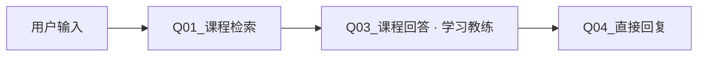

# 第 2 章：知识库与第一次可追溯答疑

## 2.1 准备导入材料

我提供了 [knowledge 文件夹](knowledge/) 中 16 个 `.txt` 文件，由本项目公开自编样例生成。每个文件开头都有来源编号、课程、主题，后面才是事实正文。先上传这些文件跑通流程，再决定是否把有权使用的完整课程上传到云端。

**为什么没有直接上传原始 CSV？** CSV 里混有 `suitable_questions` 等辅助字段。整表当普通文本导入，可能把列名和辅助问句一起作为事实来源。一个样例片段一个文件，便于初学时观察分段与来源；这不代表完整 877 个片段也应永久用 877 个文档管理。

## 2.2 创建知识库

1. 左侧点 **知识库**，点新建/创建知识库入口。
2. 选择 **导入已有文本**（若版本显示“从文件导入”，选择文件导入），点文件选择区域。
3. 打开项目中的 `docs/dify-hands-on/knowledge`，选择 16 个 `.txt` 文件上传。若套餐限制单批数量，就分批添加到同一库，不能因此重复创建和导入相同文档。
4. 继续到分段设置，先选 **通用**。分隔符使用默认段落分隔，最大分段长度先填 `800`，重叠 `0`。点击预览，确认每个样例文件整体保留且来源编号仍在片段里。
5. 如果一个文件被分成两段，先检查预览：应让这批短样例保持一个来源单元，不要盲目把 800 理解为模型 token 数。完整课程后续另做切分实验。
6. 索引方式选 **高质量**，embedding 选第 1 章确认能用的文本向量模型。
7. 检索设置选 **混合检索**。如果提供 rerank 模型选项，启用并选可用重排模型；初始 Top K 填 `6`，先关闭分数阈值过滤。若必须设置权重且暂时没有重排模型，先记录关键词/语义各 `0.5` 的基线。
8. 给知识库命名 `Course_Learning_Demo_v1`，保存并等待索引完成。看到全部文档可用后，再去调试。

**为什么这样选：** 关键词能保留 RAG、MCP 等术语，向量能覆盖“先找资料再让模型答”这样的口语表达。Rerank 重新比较候选相关性，但补不回从未召回的片段。先不设阈值是为了观察分数分布，不把任意 0.7 当成质量保证；稳定后再用开发集调参。

高质量索引、向量、全文与混合检索的关系见 [Dify 索引与检索说明](https://docs.dify.ai/zh/cloud/use-dify/knowledge/create-knowledge/setting-indexing-methods)。本地项目的“320 tokens、48 overlap、RRF、父片段去重”并不会自动映射成这里的“800、0、Top K 6”。我记录部署差异，随后做效果对照。

## 2.3 先只测试检索

1. 打开这个知识库，进入 **检索测试**或 **召回测试**。
2. 输入 `重排能把没有召回的正确资料找回来吗？`。
3. 查看结果中是否有 **S02**，并打开结果读正文。
4. 再输入 `先搜讲义再回答，还为什么会胡说？`，检查 **S01** 是否进入前列。
5. 输入 `明年某模型的 API 价格是多少？`，检查是否误把不相关片段当答案。

**怎么判断：** 搜出了一些文字不等于检索正确。第二个问题是口语改写测试；第三个是无答案测试。把预期来源、实际排名、耗时和配置记入工作簿。此时不要让 LLM 猜答案来掩盖检索错误。

## 2.4 在画布搭四个节点

1. 回到“工作室→课程智能学习助手_实操版→编排”。
2. 保留 **用户输入**；添加 **知识检索**，改名 `Q01_课程检索`。
3. 点 Q01，在右侧 **查询文本** 选择 **用户输入 / query**。
4. 在 **知识库** 点“添加 知识库”，勾选 `Course_Learning_Demo_v1`。
5. 点 **召回设置** 检查当前策略；确保不是另一个旧知识库。先不用元数据过滤。
6. 添加/复用 LLM，改名 `Q03_课程回答`，选聊天模型。
7. Q03 的 **上下文** 字段，选择 **Q01_课程检索 / result**。
8. SYSTEM 粘贴 [提示词手册的 Q03](prompts.md#q03课程回答)，其中“课程证据”位置通过 `/` 插入 **上下文** 标签。绑定上下文后还要在提示词里实际使用它。
9. USER 插入 **用户输入 / query**。先关闭这个节点的 **记忆**；第 3 章会显式管理近期对话。
10. 添加/复用 **直接回复**，改名 `Q04_直接回复`。回复内容只插入 **Q03_课程回答 / text**。
11. 连成上图；删除或断开默认直达 LLM 的旧连线，避免绕过检索。

**输入和输出是什么意思：** `result` 是检索结果列表，里面有正文和来源信息；`text` 是模型生成的文字。直接回复节点只负责把它展示给学习者，不会自行检索或再次调用模型。

## 2.5 引用要亲手验证

1. 点顶部 **功能**，找到引用/归属设置；如果当前版本提供，开启知识库来源引用。若找不到，就先使用回答中的 `[S02]` 和来源说明，不宣称已经有可点击来源卡。
2. 点 **预览**，问 `重排能修复漏召回吗？`。
3. 点击回复中的引用，检查打开的正文与 S02 一致；检查没有编造页码、视频时间戳。
4. 再问 `课程有没有给出我现在应购买哪个套餐？`。预期说明资料不足。
5. 检查 Q01 和 Q03 的“上次运行”：Q03 输入里应真实出现 S02 正文，不是“Q01/result”几个字。

**产品经理决策：** 对课程助手，我默认只把课程事实称为课程依据。没有证据时先说明不足，外部知识必须另标来源。低温度只能影响输出随机性，不能替代检索或事实核验。

## 2.6 单课与全部课程

先跑全部课程。要加课程范围：在用户输入节点添加文本/下拉字段 `course_scope`，值为 `all` 或样例课程编号。给每个知识文档添加同名元数据 `course_id`，按文件头填写；从“知识检索→元数据过滤→手动”选择它。使用条件分支分成 `all` 的不筛选检索节点和其他值的 `course_id = course_scope` 检索节点，结果用变量聚合器合成 `result` 再交给教练。

**不要误解：** 文本中写着“课程01”只是内容，不等于已经建立元数据过滤。若当前套餐/界面不支持这个设置，先在 UI 明确标记“全部课程”，不能口头声称已经隔离单课。第 3 章状态也必须保存这个范围；开始新练习时使用同一范围，修改课程后清空待作答题，避免用另一门课评判旧题。

**本章通过条件：** 有答案题能定位来源；无答案题说明不足；实际 Q03 输入包含检索正文；至少记录 3 个检索测试。进入 [第 3 章](03-状态与语义识别.md)。
