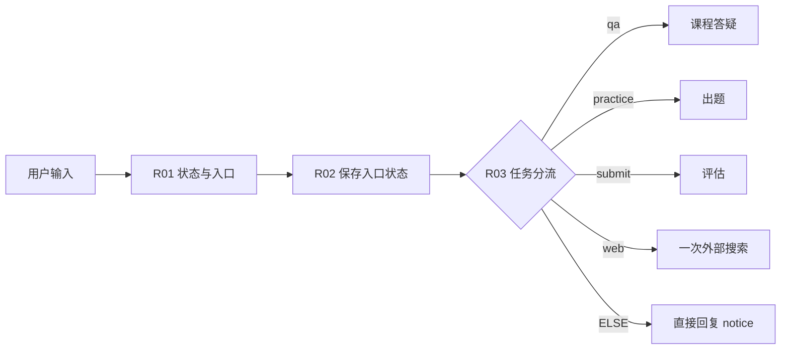

# 第 3 章：让系统知道“现在在做什么”

## 3.1 先理解状态，而不是再加一个调度 Agent

如果用户正在答题，又问了一句“第二题什么意思”，系统应该解释题意，不能把这句话当交卷。明确的入口、当前状态和语义判断共同决定下一步。我的取舍是：普通问题可用语言模型理解；正式交卷、偏好保存、外部搜索使用明确操作，减少误记成绩和误联网。

主线先支持这些输入：

| 输入 | 系统行为 |
|---|---|
| 普通中文问题 | 课程答疑 |
| `/练习 RAG 的职责与边界` | 生成并审核三题 |
| `/作答` 后按三行编号写答案 | 仅在存在待作答题且三题完整时评分 |
| `/退出练习` | 清空待作答题，不计成绩 |
| `/复习` | 取最早到期知识点，生成变式练习 |
| `/偏好 我是零基础，请多用产品例子` | 保存明确偏好 |
| `/删除偏好` | 清空偏好及近期模型上下文 |
| `/记录` | 展示本会话最近有效成绩 |
| `/联网 Dify 官方 MCP 文档` | 明确允许本轮一次搜索 |

命令是首版聊天界面的交互约定，后续可以改成按钮。产品经理应承认它比专用工作台更粗糙，同时说明它降低了原型中的误触风险。

## 3.2 建立一个会话变量

1. 在画布顶部点 **会话变量**，点 **添加变量**。
2. 名称填 `learning_state`；类型选 `string`。
3. 默认值填 `{}`，不是空白、不是带外层引号的 `"{}"`。
4. 描述填 `同一聊天中的偏好、待作答题、近期有效成绩与复习队列；v1`，点保存。

我用 JSON 字符串把教程里的状态集中起来，便于复制与查看；这是教学原型的存储方式，不是数据库设计建议。会话变量在同一个聊天的不同轮次中保留；新聊天通常得到默认值。它不等于跨会话长期档案。[官方会话变量说明](https://docs.dify.ai/zh/cloud/use-dify/nodes/variable-assigner)

## 3.3 添加确定性路由

1. 在用户输入之后添加 **代码执行**，改名 `R01_状态与入口`，语言选 Python。
2. 删掉默认代码，复制 [router.py](code/router.py) 全文。
3. 输入变量按下面逐项添加，名字必须与函数参数完全一致：

   | 输入名称 | 绑定到 |
   |---|---|
   | `query` | 用户输入 / query |
   | `saved_state` | 会话变量 / learning_state |
   | `scope` | 用户输入 / course_scope；未做范围功能时填常量 `all` |

4. 输出变量添加 `action、topic、answers、pending、context、state、notice、review_topic`，类型全部选 **String**。
5. 后接 **变量赋值**，改名 `R02_保存入口状态`。目标选 **learning_state**，操作选覆盖/Overwrite，值选 **R01_状态与入口 / state**。
6. 再接 **条件分支**，改名 `R03_任务分流`。依次设置 `action 等于 qa`、`practice`、`submit`、`web`；ELSE 接直接回复，回复变量为 **R01 / notice**。
7. `qa` 出口接第 2 章的检索链；另外三个出口暂时接说明“本功能正在搭建”的直接回复，后续逐个替换。

**为什么先保存入口状态：** 偏好更新和退出练习不需要模型，应该立即生效；搜索尝试计数也先增加，失败仍算尝试。成绩则不在这里写，只能在有效评分通过后写。

**检查：** 输入 `/偏好 我是零基础`，预期无需调用 LLM 即返回确认；再输入 `/作答`，预期“没有待作答题”。检查运行详情中没有评分节点被执行。

## 3.4 给证据编一个明确的可引用编号

在 Q01 检索与 Q03 回答之间加 **代码执行**，改名 `K02_证据整理`。

1. 复制 [evidence.py](code/evidence.py)。输入 `results` 绑定 **Q01 / result**，输入类型来自列表变量。
2. 输出添加 `evidence、catalog、source_ids、has_evidence`，全是 String。
3. Q03 的 SYSTEM 保留共同规则及已插入的“上下文”正文标签；USER 除当前问题外，再插入 **K02 / catalog** 和 **R01 / context**，标记为“允许引用的来源目录 JSON”和“必要学习上下文 JSON”。正文已经在上下文里，不再重复插入 evidence 全文。
4. Q03 的上下文字段仍保留 Q01/result，便于 Dify 原生引用。样例正文自带来源编号，目录提供编号与标题对应；完整课程转入时也应保留来源编号。不要再开启自动聊天记忆。
5. Q03 后添加 `Q05_检查引用与近期记忆` 代码节点，复制 [save_answer.py](code/save_answer.py)。
6. 输入：`answer=Q03/text`、`source_ids=K02/source_ids`、`state_json=R01/state`、`query=用户输入/query`。
7. 输出：`display、state`，均 String。
8. 后接变量赋值，覆盖 `learning_state = Q05/state`，再直接回复 **Q05 / display**。

**代码保证到哪里：** 它能拒绝不在本轮证据白名单的引用 ID，并只保存近期 6 个问答对；不能自动证明每个事实都被来源支持。引用支持率仍需人工逐项审阅。它是整段输出后检查，因此会增加首个正文的等待；不要把原本直接流式的性能目标照搬过来。

## 3.5 再加入语义识别，观察是否值得保留

在 `qa` 出口与 Q01 之间添加 **问题分类器**，改名 `I01_学习意图`。模型沿用聊天模型，输入选 R01/topic。建四类：

| 类别 | 填写的描述 | 出口 |
|---|---|---|
| `explain` | 询问课程概念、步骤、术语、例子或知识边界 | Q01 |
| `compare_apply` | 比较两种方案，或把课程知识应用到产品场景 | Q01 |
| `practice_request` | 自然语言明确要求出题、交卷、复习；不代表已正式提交 | 回复“请输入 /练习 知识点；正式交卷用 /作答” |
| `clarify` | 指代无法还原、条件缺失，无法确定要解释什么 | 回复“请补充你指的概念或课程，例如 RAG 与微调的区别” |

解释/比较出口都可以连同一个 Q01，不必新增两个教练。第 3 类先引导显式操作；熟悉后可优化为自然语言选择题，但评分入口仍需明确提交。

要改善“它有什么局限”的追问，可在这两个出口与检索之间加 `I02_检索问题改写` LLM，使用 [I02 提示词](prompts.md#i02检索问题改写)，输入当前问题与 R01/context。Q01 查询改为 I02/text；Q03 仍回答原问题。改写节点 Memory 关闭，不让它自行加用户没有问过的限制。

**产品实验：** 分别测“没有分类/改写”与“有分类/改写”的相同 10 个问题。只有路由错误、追问检索改善足以抵偿额外模型延迟时，才保留新增节点。普通定义问题不一定值得多调用两次模型。

**通过条件：** 查询不会误计成绩；偏好可更新删除；引用假编号被拦截；当前题意询问仍走答疑。进入 [第 4 章](04-练习与双角色评估.md)。
