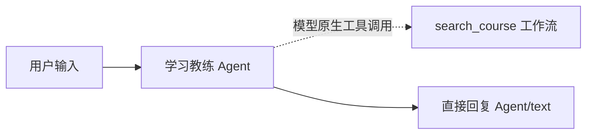

# 第 6 章：真实 Agent、Tool Calling 与一个 MCP

## 6.1 为什么既有固定检索，又要做 Agent 实验

固定 RAG 对明确问题通常更可控。Agent 的价值在于根据任务主动决定是否补充查找，而代价是额外模型调用、延迟和更难约束的路径。我先保留已经能用的固定流程，再复制应用做 Agent 对照，比较后决定哪些任务值得采用它。不要为了工具调用截图强迫每个简单问答多查三次。

**操作：** 回到工作室，找到实操版卡片的更多菜单，选择“复制”（若菜单没有复制，导出后重新导入为新应用）。命名 `课程智能学习助手_Agent实验`。原版作为固定流程基线。

## 6.2 把课程检索做成工作流工具

1. 工作室→创建→创建空白应用，选 **工作流**，名称 `课程检索工具_v1`。
2. 在用户输入节点添加 `query`（String，必填，描述：精简的课程检索问题）。主线先固定全部演示课程，不让模型选择任意库。
3. 后接知识检索，选 `Course_Learning_Demo_v1`，查询文本绑定 **用户输入 / query**。
4. 后接代码执行，复制 evidence.py；输入 results=知识检索/result。
5. 后接 **输出** 节点。新增输出字段 `evidence`，值选证据代码/evidence；字段 `source_ids` 选证据代码/source_ids。
6. 点预览/测试，输入 `重排能否解决漏召回`，确认输出 JSON 字符串中含 S02 的真实正文。
7. 点右上 **发布**，先发布/更新工作流，再选择 **发布为工具 / 工作流作为工具**。工具名称填 `search_course`，展示名填 `课程证据检索`。
8. 工具描述粘贴：

   ```text
   检索本应用课程整理文本，用于核对课程术语、定义、比较与应用边界。
   输入精简中文问题；返回来源编号及原文证据，不返回已经验证的最终答案。
   未找到足够证据时应说明不足，不用于查最新价格或私人档案。
   ```

9. query 参数由模型推理填写。点击保存后，在“集成→工具→工作流作为工具”确认这个工具存在。

如已完成单课过滤：给工具增 `course_scope` 输入，在内部用与第 2 章相同的过滤分支；Agent 配置中把 scope **手动绑定用户选定范围**，只把 query 交给模型。不能让模型靠提示词自行遵守范围权限。

Workflow 可以发布成工具，Chatflow 不能当成这种工作流工具；发布工具后须核对版本，修改草稿并不意味着所有调用都已用上新版本。[Dify 工具说明](https://docs.dify.ai/zh/cloud/use-dify/workspace/tools)

## 6.3 搭一个真的学习教练 Agent

在 Agent 实验版中，先独立测试下面的小链，再接回主线：



1. 画布左侧“+→节点→Agent”，命名 `A01_学习教练Agent`。
2. 如面板先区分“经典 Agent / 新 Agent”，选 **经典 Agent**；本节要配置策略和工具，不选择一个已发布的 New Agent。在 **Agent 策略** 选择 **Function Calling / 函数调用**。若没有策略，去“集成→Agent 策略”或 Marketplace 安装官方 `langgenius` 的 Agent 策略，回到画布刷新选择。
3. 模型选确认支持原生工具调用的模型。第 1 章普通聊天成功不等于工具调用已通过。
4. 指令粘贴 [A01 提示词](prompts.md#a01学习教练agent)。Query/查询绑定用户输入/query。
5. 工具列表点添加，选择“工作流”下的 **课程证据检索**；仅提供这一个只读工具。不加任意代码、任意数据库、网络抓取等工具。
6. query 参数选由模型推理；最大迭代次数先填 `3`，Memory 关闭。模型如果提供 temperature，可先用 `0.2` 作为基线，不把它当事实保证。
7. 直接回复绑定 **A01 / text**，输入“重排能修复漏召回吗，依据是什么？”运行。
8. 打开 Agent 的上次运行/执行详情，找到真实工具名、query 参数和返回正文。只有看到工具执行结果才算 Tool Calling 成功；模型说“我检索了”不算。

Function Calling 使用模型原生工具接口；ReAct 是另一种策略，通常依赖文本行动格式解析。能输出 JSON 并不证明能使用原生函数调用。最大迭代次数也不是精确的外部请求总数控制器。[官方 Agent 节点说明](https://docs.dify.ai/zh/cloud/use-dify/nodes/agent)

**引用差异：** Agent 经工作流工具得到的资料不一定自动生成与 Q03 上下文相同的可点击引用卡。测试时先看来源 ID 与工具原文，不能把看不到的来源 UI 说成已经实现。主线的固定检索与引用检查保留作可信回答基线。

## 6.4 把 Agent 放在有价值的位置，而非整条链替换

我提供两个可选实验，先做 A，再根据结果决定是否做 B。

### A：让教练主动探查术语，再做受控检索

在实验版把第 3 章 I02 改写节点替换为 A01；指令改为 [A02 检索准备](prompts.md#a02检索准备)。它可调用 search_course 理解课程里的术语，最终只输出一条检索问题。Query 给原问题和 R01/context，后接代码节点 `A02b_检索词限长`：

```python
def main(proposed: str, original: str) -> dict:
    query = proposed.strip()
    return {"query": query if 0 < len(query) <= 200 and "\n" not in query else original[:200]}
```

输入 proposed=A01/text、original=R01/topic；输出 query 为 String。后面的 Q01 检索用这个 query，Q03 只依据实际 Q01 检索结果回答，继续经过 Q05 引用检查。

**为什么仍有 Q01：** Agent 探查结果用于找检索方向，最终事实依据由固定检索显式传入。这样保留可检查的来源白名单，也会多一次检索和模型往返。对普通定义问题可能不划算；优先在分类器的 compare_apply 分支试验，不默认全量开启。

### B：让评估员也能只读核查课程

1. 仅在实验版，把 G01 复制为 Agent `G01A_评估Agent`，Function Calling、独立上下文、相同课程检索工具，最多 3 次迭代，Memory 关闭。
2. 指令使用 G01 评分规则，追加“必要时可用课程检索工具核对术语；最终评分只引用 pending 里原题允许的证据 ID。工具补充若与原证据冲突，返回失败说明，不擅自增加评分要求”。Query 只给 R01/pending 与 R01/answers，不给教练主观评价或偏好。
3. 要求最终 text 是 grade.schema.json 对应的单个 JSON 对象，不带 Markdown；不要以为 Agent 的 JSON 诊断输出就是最终评分对象。
4. G01A/text 直接绑定 G03 的 `grade`，跳过 G02。G03 解析或校验失败必须走失败出口，不能存成绩。先用 3 个测试答案证明它能稳定返回正确格式，再扩评分实验。
5. 保留原版 G01 LLM 的结果作为对照，比较人工一致性、延迟、Token、格式失败率和实际补充检索次数。

到这里两个角色均可有自主只读核查能力，Graph 负责交接和结束；没有新增调度员、记忆管理员或第三个角色。若 Agent 版没有质量收益，真实产品保留较轻的固定评估流程也是合理决策。报告要如实写“已验证的能力”与“最终采用的路径”。

## 6.5 连接唯一的外部 MCP：Tavily

以下字段按当前账号实际弹窗核对；**本地 `.env` 的 Key 不会自动进 Dify**。

1. 左侧 **集成→工具→MCP**。
2. 点 **添加 MCP 服务（HTTP）**。
3. **服务端点 URL** 填 `https://mcp.tavily.com/mcp/`。
4. **名称和图标** 填 `Tavily 课程外查证`；**服务器标识符** 填 `tavily_learning`。标识符要稳定，后面应用按它引用。
5. 点弹窗中的 **请求头** 页签，再点 **添加请求头**。
6. 名称填 `Authorization`，值由你自行填 `Bearer 你的Tavily_API_Key`。不要真的填“你的…”；Bearer 后有一个空格。不要把 Key 写入 Query 或公开截图。
7. 点 **添加并授权**，等待发现工具列表。若失败，先检查鉴权、网络、账户额度；不要为了绕过错误切换付费研究工具。
8. 只选择基础搜索工具。实际名称以服务发现结果为准，通常是 `tavily_search` 或带连字符的搜索名；不要同时接 research、crawl、extract、map。

Tavily 官方支持远程 MCP、OAuth 与 API Key 请求头认证；Dify 的 HTTP MCP 负责发现并导入工具，不是把普通 HTTP 搜索改个名字。[Tavily MCP](https://docs.tavily.com/documentation/mcp)、[Dify MCP 接入](https://docs.dify.ai/zh/cloud/use-dify/workspace/tools#mcp)

## 6.6 在 web 分支做一次受控搜索

1. R03 的 `web` 出口添加 **工具节点**：点“+→工具→MCP→Tavily 课程外查证→基础搜索”。
2. 命名 `W01_一次基础搜索`。query 绑定 R01/topic；`search_depth` 手动固定 `basic`；`max_results` 手动固定 `5`；`include_raw_content=false`；关闭/不启用自动扩展参数和高级搜索。若工具版本无某个字段，记录实际 Schema，不要假称已经固定不存在的参数。
3. 关闭节点的失败重试。W01 后接 LLM `W02_外部补充`，Memory 关闭，SYSTEM 用 [W02 提示词](prompts.md#w02外部补充)，USER 给原问题与 W01 的实际结果字段。
4. 如果 W01 输出为 text/json，按“上次运行”的实际变量选择；不要盲选并不存在的 result。首次测试后再把对应输出绑给 W02。
5. W02 后接直接回复；W01 异常处理设为 **失败分支**，直接回复“外部查证未完成，你仍可继续问课程问题”。W02 失败也给明确错误，不能伪装成查证成功。
6. 不把 W01 结果接到 P00、G01 或 knowledge 导入；课程练习评分仍只用课程证据。

**此处为何使用固定工具节点：** 一次明确授权的搜索只有一个节点，失败不重试，能直接检查实际调用。Agent 仍在课程检索实验中使用原生 Tool Calling；MCP 并不要求所有调用都由模型自主决定。

**额度的准确说法：** router.py 限制同一会话最多 10 次搜索尝试，失败也计；新会话会重置。原项目的“每月最多 300 次”是本地应用自行设置的全局上限，不是 Tavily 免费套餐本身保证的额度。账户免费额度、已用 credits 和付费设置以 [Tavily 控制台](https://app.tavily.com/) 为准；本教程不要求开启付费。要严格复现每月全局 300 次，需要共享持久存储和原子扣减服务，提示词无法保证。

**本章验收：** 关闭外部查证时不调用 Tavily；明确 `/联网` 才调用；一次只有一个基础搜索节点；失败提示准确；实际工具轨迹能证明课程检索工具和远程 MCP 都被真正调用。进入 [第 7 章](07-调试评测与发布.md)。
