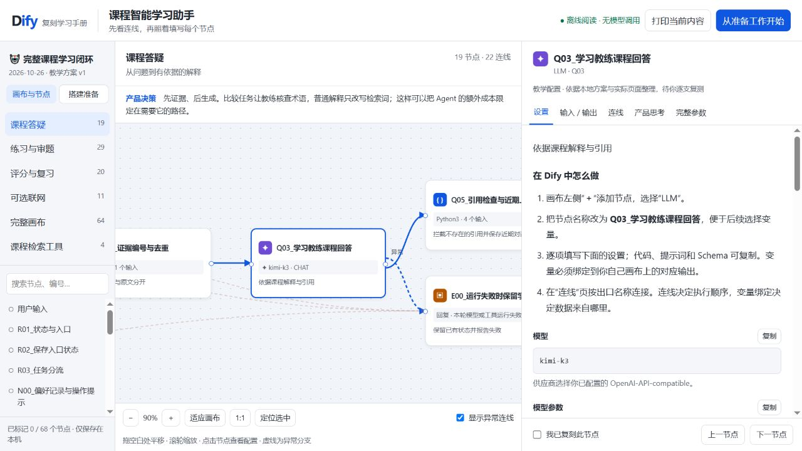

# 我的 Dify 可视化搭建手册

我把这套课程学习助手做成了一份独立的离线教学文档。**直接双击 [课程助手-Dify可视化搭建手册.html](课程助手-Dify可视化搭建手册.html)**，即可在浏览器查看；它不连接 Dify，不读取密钥，不调用模型，也不需要启动项目后端。

我参照实际观察的 Dify Cloud 画布与节点配置面板制作了布局。它是教学界面，节点布局为阅读重新整理，参数来自本地版本化方案和官方说明，不是 Dify 官方页面，也不是云端草稿的实时镜像。



## 我怎样使用这份手册

1. 点击右上角“从准备工作开始”，依次准备模型、完整知识库、会话变量、内部检索工具和可选 MCP。每章都写了点哪里、填什么、为什么和怎么验收。
2. 回到“画布与节点”，先看“课程答疑”，再看“练习与审题”“评分与复习”“可选联网”。拖动画布平移，滚轮缩放，点击“适应画布”查看当前分支全貌。
3. 点击节点，右侧“设置”列出具体填写内容，提示词、代码和 Schema 可以复制；“输入/输出”显示变量名及绑定来源；“连线”列出每个 CASE、ELSE 和异常出口；“产品思考”解释用户问题、成本、风险和验证方法。
4. 变量表达式是手册标记。复制后，在 Dify 用变量选择器换成自己节点的真实变量标签，不直接把 Q03 等自定义 ID 当成你账号的内部 ID。
5. 每搭完一个节点，可勾选“我已复刻此节点”。这里只在本机浏览器记录节点编号，不保存任何密钥或课程内容。搜索框可找全部 68 个节点。
6. “完整画布”展示主流程 64 个节点与 79 条连线；“课程检索工具”另有 4 个节点与 3 条连线。多个错误处理节点与代码节点不代表增加了多个 Agent，产品仍只有教练、评估员两种角色。

## 我的默认搭建配置

**2026-10-26 模型变更提醒：**你已报告工作空间默认值改为 Xing4.0-29B / bge-m3 / bge-reranker-v2-m3。下表与交互手册保留旧教学基线；先读[模型配置变更说明](模型配置变更说明.md)，核对显式节点绑定和知识库索引。默认选择变化不等于迁移已完成。

| 内容 | 方案 | 约束 |
|---|---|---|
| 完整知识库 | 14 节课、877 个父分段，父子模式 | 私人课程和实际工作空间 ID 不在公开手册里 |
| Embedding | qwen3.7-text-embedding-flash | 按你指定的模型；Dify Cloud 调云端服务 |
| 检索 | 语义 0.7、关键词 0.3；Top K=6；阈值关闭 | 不用模型 rerank；不是本地 RRF 的精确复现 |
| LLM | kimi-k3 | temperature 不传；普通输出上限 3000，结构化/Agent 5000，待复测 |
| 双角色 | 教练出题/辅导，评估员独立审题/评分 | 两个经典 Function Calling Agent 通过只读工具核查，其他 LLM 是角色的具体任务 |
| Memory | 当前聊天的偏好、待作答题、有效成绩和复习队列 | 不等同 SQLite 跨会话档案；新聊天不保证继承 |
| Skills | 概念讲解、三题练习、薄弱点复习的版本化指令 | 映射到经典 Chatflow 的分支，不声称原生 New Agent Skills |
| MCP | Tavily 官方 MCP 基础搜索 | 默认关闭；显式 /联网 才调用；每会话 10 次不是全局每月 300 次 |

单文件 CSV 的课程编号在正文中，不能直接提供严格的文档级单课过滤。手册说明了需要按课拆文档并配置元数据，或对接本地检索服务的后续条件。Dify 自带 Web App 也不等于本地 React 三栏工作台。

## 我如何标注验证状态

此前实际完成过完整库索引、混合检索，主 Chatflow 配置检查通过；一次问答经过最终回复，但输出以 length 截断，缺少完整解释和引用，不能算质量验收通过。temperature 不兼容问题已在教学参数中修正，输出预算也已增加；后续按你的要求转为你自己复刻和测试，**没有继续在 Dify 导入或试跑这些最终参数**。

三题练习、独立评分、复习、真实 Agent 工具轨迹和联网完整分支仍需你逐支验收。17 项离线规则检查只能证明确定性代码的已覆盖行为。人工金标、单/双角色消融、延迟和 7 天试用还未完成。详细记录见 [验证记录](验证记录.md)。

## 其他阅读材料

- [逐节点参数手册](逐节点参数手册.md)：主流程 64 个节点的纯文本参数。
- [完整实操讲义](../完整实操讲义.md)：从空白应用开始的章节教程。
- [visual-guide-data.json](visual-guide-data.json)：可视化手册的公开脱敏节点数据。
- [guide_content.py](guide_content.py)：按节点维护的教学解释、产品决策和验收检查。

这份手册已经内嵌全部必要内容，HTML 文件可以单独复制到其他目录阅读。页面底部的 Markdown 扩展阅读链接需要保留仓库目录；官方链接需要网络。

维护者修改模板或教学说明后，可在项目目录运行：

```powershell
.\.venv\Scripts\python.exe -X utf8 docs/dify-hands-on/showcase/build_visual_guide.py --from-data docs/dify-hands-on/showcase/visual-guide-data.json
```

该命令仅重建静态文件，不发起任何 API 请求。代码沿用项目 MIT 许可；界面参照 Dify 的使用习惯，本手册与 Dify 官方无隶属关系。私人课程、密钥、实际 DSL 与含私有课程的截图留在本地。

文档检查入口：`python docs/dify-hands-on/showcase/check_visual_guide.py`。它核对 68 个节点、82 条边、字段引用、无环连接和离线资源约束。界面已在本地浏览器检查 12 个代表节点的 5 个详情页，以及内部工具与知识库准备章节；这不涉及模型或课程质量评测。
