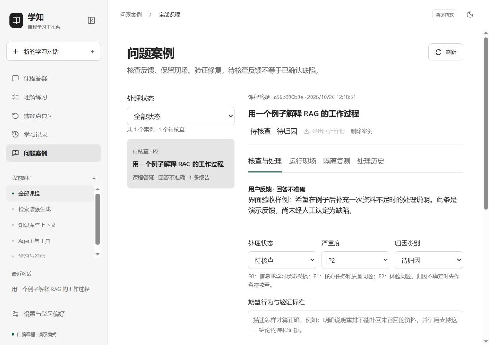

# v1.1.0：我如何建立 badcase 闭环

日期：2026-10-26。基于提交 `2756fc5` 开始，保留 `v1.0.0` 标签及其档案不变。该版本是个人内测功能迭代，没有重新宣称课程质量、性能或商业验收达标。

## 问题与决策

v1.0已有 Evals 候选、人工审阅入口和运行日志，但用户在学习时发现的问题缺少直接反馈入口，日志也不足以复现当时的证据和上下文。我选择最小完整流程，而不是只新增“踩”按钮或搭建团队工单平台。

| 决策问题 | 证据与备选 | 我的选择与原因 | 成本、风险及重验条件 |
|---|---|---|---|
| 反馈是否等于badcase | 不满意可能来自题意、资料或预期差异；直接写gold会污染评测 | 用户/自动线索先待核查，实际人工确认归因与标准 | 增加审阅工作；积累真实案例后检查归因一致性 |
| 保存日志还是复现现场 | 原日志含版本/耗时/Token，但缺原请求、证据与上下文 | 扩展traces快照，新增feedback/badcases两张表 | 私人数据占用增加；越界截断并标记，删除联动；资料规模扩大后再做保留期限与存储统计 |
| 是否逐字重放API | 历史工具结果和模型具有随机性；只看新检索会混入数据变化 | 固定资料池与当前知识库两种范围，明确不同验证能力 | 不能保证同样工具路径；检索归因必须用当前知识库验证 |
| 复测能否复用正式学习库 | 练习生成与成绩会影响复习计划 | 临时库重建上下文，前后校验正式学习摘要 | 多一层隔离代码；新增状态表或写入路径时更新摘要与测试 |
| 自动检查能否关闭 | 来源编号有效不等于证据支持；结构成功不等于分数正确 | 当前标准+修复版本匹配的成功复测，再由实际审阅者判定 | 单人确认仍可能偏差；多人试用后再考虑复核流程 |
| 回归集是否并入锁定测试集 | 围绕已知问题优化会高估泛化效果 | 导出独立regression JSONL，不触碰测试锁 | 维护两类数据；新增质量目标时需要独立新测试题 |
| 是否增加Agent/MCP | 核查、去重和权限属于确定性业务规则 | 沿用两Agent，一个搜索MCP；复测不新增联网调用 | 不自动语义聚类、不自动归因；真实人工负担明显时再实验 |

## 关键节点与验证

1. **审计现状**：确认原有37项测试和前端构建通过，定位运行日志不能完整复现的缺口。
2. **现场与流程**：加入快照、精确去重、自动待核查、人工状态机、修复标准绑定与私有导出。
3. **隔离与删除**：实现三种任务复测，禁止新联网和正式成绩写入；修复删除偏好时多条反馈清空后唯一约束冲突；服务重启将未完成任务标为中断。

   发布复查补充：评分的当前知识库复测原先可能夹带原题旧来源正文。我改为按ID刷新当前资料，缺失则明确失败，增加历史现场不被修改、来源更新/删除的回归；界面提供本次证据与检索记录。该补充没有额外运行真实模型质量评测。
4. **工程验证**：新增28个参数化测试实例，总计65项通过；Ruff和React/TypeScript/Vite构建通过。包含真实TCP断开复测后取消留痕、锁释放、正式学习不变，以及原生兼容协议模拟下的上下文/工具快照。
5. **真实API机械验证**：一次自编课程答疑固定资料池复测完成，12,428ms，输入1,484 Token、输出405 Token；执行、引用编号、工具/结构和隔离检查通过。没有新的MCP请求。原始本机报告位于 `runtime/badcase-live-probe/result.json`，公开摘要见 [报告](../../reports/badcase-live-smoke.json)。模型配置和文件指纹以报告为准。
6. **界面验证**：自编数据独立测试库中，从回答提交反馈并打开案例；检查待核查不能复测/导出、核查表单、固定/当前知识库说明、运行现场、390px导航折叠、Tab焦点顺序和明暗主题。没有代替用户勾选实际人工核查，也没有将演示反馈假装成已关闭真实缺陷。

验证范围：三种任务×两种复测策略均有演示协议隔离测试；真实LLM只验证了一次答疑固定资料池，没有本轮真实出题/评分复测质量、真实GPU检索消融或完整人工关闭验收。既有课程质量评测仍有待审阅项，不用机械检查替代语义质量证据。

## 我会怎样复盘

每条实际案例应记录：发现入口、原运行ID、影响任务、严重度、人工归因、期望行为、修改点、修复版本、复测范围、前后输出、自动检查、人工判断及依据。程序保存每次处理时的标准前后值、复测尝试和复验历史，失败也保留。

我先观察实际试用中的反馈是否足以复现，以及从确认到复验是否走得通。后续可人工从状态/历史计算确认率、归因分布、修复周期、复发情况；目前没有真实样本基数，不给出百分比，也没有实现团队运营看板。

下一步是由我本人实际审阅并处理真实案例，配合既有gold标注与七天试用验证学习价值；不是继续增加Agent数量。完整操作说明见 [badcase文档](../../badcase.md)。

## 求职表述与追问准备

我可以表述为：**设计并实现学习场景badcase闭环，将答疑/评分反馈与运行现场关联，支持人工分级归因、两种隔离复测及回归样例沉淀，通过状态门槛与数据隔离避免未经审核的标签和复测成绩污染学习档案。**

需要解释清楚的追问：

- Evals衡量预设样本上的表现，badcase收集真实使用中的失败并推进修复；确认案例再进入回归，而独立测试集保持锁定。
- 固定资料池用于隔离生成/评分变化，当前知识库包含检索变化；它们不能互相替代。
- 自动检查处理结构、来源编号、工具权限和写入隔离；主张是否得到支持、分数是否合理仍需要实际人工审阅。
- SQLite是真实业务存储，SQL是操作它的语言；反馈/案例归档与成绩事务是确定性后端逻辑，不交给LLM决定。
- 当前已交付机制并验证工程链路，没有证据宣称幻觉率降低、评分准确率提高、用户留存增加或机构成本下降。
